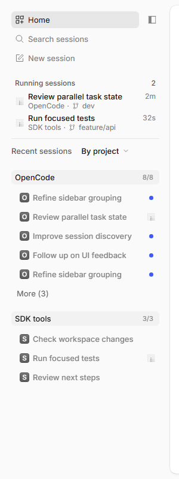

# OpenCode My

[简体中文](#简体中文) | [English](#english)

面向日常开发的桌面 AI 编程工作台。基于 OpenCode，保留完整的编程与智能体能力，重点优化使用界面、个性化流程和本地模型体验。

A desktop AI coding workspace for everyday development. Built on OpenCode, it retains the full coding and agent capabilities while improving the interface, personal workflows, and local model experience.

<p align="center">
  <picture>
    <source media="(prefers-color-scheme: dark)" srcset="docs/fork/dev-my/sidetab-overview-dark.png">
    
  </picture>
</p>
<p align="center"><sub>Side bar（本地模式）：运行中的任务、按项目分组的最近会话、分支与运行时长一屏可见。截图为合成数据。<br>Side bar (local mode): running tasks, recent sessions grouped by project, branches, and elapsed time in one view. The screenshot uses synthetic data.</sub></p>

## 简体中文

自 Windows 测试版 `v2.2.3-dev-my.4` 起，任务概览独立为第四种 Side bar；官方 Side tabs 保持原行为。首次人工测试已通过，[设计与验证记录](docs/fork/dev-my/sidebar-mode.md)。稳定 Latest 仍为 `v2.2.3-dev-my.3`，Windows 完整安装包在 [GitHub Release](https://github.com/joe-ieta/opencode/releases/tag/v2.2.3-dev-my.3)。

最新测试版 [v2.2.5-dev-my.2](https://github.com/joe-ieta/opencode/releases/tag/v2.2.5-dev-my.2) 提供 Windows x64 完整安装包与 Linux amd64/arm64 AppImage/deb。三个目标的安装包、远端摘要与公开下载入口均已核验；产物未签名，本次新包 GUI 尚未人工验收。详情见 [发行记录](docs/fork/dev-my/releases.md)。

`dev-my` 已吸收上游 V2 2.2.5 `dev@ff90ed9160`，保留项目整组收起、分组排序、深层子智能体状态与标题方向修复。Side bar 开发统一在 `dev-my`；[#60867](https://github.com/anomalyco/opencode/pull/60867) 已同步最终修改，远端 `sidebar-mode` 仅冻结保留 PR 引用，本地分支及两端旧 `sidebar-projects` 已收口。测试版标签固定在 `3777b783c5`，不包含并行任务后来提交的 Session activity / goal state 工作。[验证与构建记录](docs/fork/dev-my/releases.md)。

### 项目定位

OpenCode My 把改动集中在每天都会用到的三件事上：

- **使用界面优化**：新增本地 Side bar（`sidebar`）模式，将首页、运行任务、最近会话和项目历史收进同一个侧栏；官方 Top tabs、Side tabs 和 Inbox 继续跟随上游。正在运行的任务即使没有打开标签也能看到，分支、工作树和运行时长随任务更新。
- **个性化流程定制**：最近会话默认按项目分组，每个项目默认显示 5 条并可展开；项目旁可直接新建会话。关闭标签或隐藏历史条目会保留会话，Home/搜索可重新打开。
- **本地使用偏好**：沿用系统语言与主题，记住标签布局、分组和排序偏好；项目、会话历史与配置保存在本机，使用本地模型不依赖额外的云端账户。

欢迎在 [Issues](https://github.com/joe-ieta/opencode/issues) 提出功能建议或反馈问题，帮助我们改善界面、消息查看等使用体验，尤其是长任务跟踪和多项目并发开发监控。我们会尽力改进完善。

### 项目来源

OpenCode My 在 [joe-ieta/opencode](https://github.com/joe-ieta/opencode) 维护，官方上游为 [anomalyco/opencode](https://github.com/anomalyco/opencode)，发行桌面应用 **OpenCode My**。远端与三条维护分支的顶层约束见 [AGENTS.md](AGENTS.md)。

- 每次同步先合并上游对应分支，再叠加本仓库尚未被上游接纳的界面与可靠性补丁。
- 编程、工具调用、子智能体、MCP 等核心能力随上游更新，不在 fork 中另起一套内核。
- 桌面使用独立的 GUI 身份和本 fork 的更新源；后台仍沿用 OpenCode `dev` 渠道的服务、配置和历史约定。
- 本仓库 `origin` 只使用 GitHub，官方仓库为 `upstream`；仅长期维护 `dev-my`、`oc-headless`、`qt-headless`。
- 当前发行包含 Windows x64 与 Linux x64/arm64 AppImage/deb；macOS 尚未提供本 fork 的构建验证。
- 维护分支、同步方法和发行记录见 [FORK.md](FORK.md) 与 [docs/fork](docs/fork/README.md)。

### 本地模型支持

本地模型沿用 OpenCode provider 体系，不另造一套接口，配置和切换更直接：

- 统一走 OpenAI 兼容配置与本地模型发现，Ollama、LM Studio、vLLM、llama.cpp 等本地服务可按同一方式接入。
- 本地模型与云端模型共用模型选择、会话和工具流程，不为本地运行单独维护客户端。
- 修复自定义/本地模型因发布日期未知而被误判为旧模型并隐藏的问题；手动隐藏仍然优先。
- 不强制登录云端服务，模型地址、凭据和自定义模型配置留在本机，适合离线或内网开发。
- 本地模型仍受上下文长度、工具调用能力等自身限制；配置方法见[OpenCode Providers 文档](https://opencode.ai/v2/docs/providers)。

### 文档与发行

- [FORK.md](FORK.md)：fork 定位、三个维护分支和上游贡献状态
- [docs/fork](docs/fork/README.md)：维护、同步、验证、发布与 Qt/headless 资料
- [dev-my 桌面发行](docs/fork/dev-my/README.md)：Side bar、桌面身份、配置和运行时约定
- [Releases](https://github.com/joe-ieta/opencode/releases)：所有平台的完整安装包与更新清单统一在本仓库 GitHub 发布。

## English

Since the Windows test release `v2.2.3-dev-my.4`, the session overview has been available as a fourth, independent **Side bar** mode; the official Side tabs mode retains its original behavior. Initial manual testing passed; see the [design and validation notes](docs/fork/dev-my/sidebar-mode.md). The stable Latest release remains `v2.2.3-dev-my.3`, with the complete Windows installer available from [GitHub Releases](https://github.com/joe-ieta/opencode/releases/tag/v2.2.3-dev-my.3).

The latest test release, [v2.2.5-dev-my.2](https://github.com/joe-ieta/opencode/releases/tag/v2.2.5-dev-my.2), provides a complete Windows x64 installer and Linux amd64/arm64 AppImage and deb packages. Installers, remote checksums, and public download links have been verified for all three targets. The packages are unsigned, and this new build has not yet undergone manual GUI acceptance testing. See the [release records](docs/fork/dev-my/releases.md).

`dev-my` includes upstream V2 2.2.5 at `dev@ff90ed9160`, retaining collapsible project groups, group sorting, activity tracking for deeply nested subagents, and text-direction fixes for titles. Side bar development is consolidated in `dev-my`; [#60867](https://github.com/anomalyco/opencode/pull/60867) includes the final changes, and the remote `sidebar-mode` branch is frozen solely to preserve the PR reference. Its local branch and the old `sidebar-projects` branches on both remotes were removed. The test-release tag is fixed at `3777b783c5` and excludes the Session activity / goal state work committed later by a parallel task. See the [validation and build records](docs/fork/dev-my/releases.md).

### Project focus

OpenCode My focuses its changes on three parts of everyday development:

- **Interface improvements**: the local Side bar (`sidebar`) mode brings Home, running tasks, recent sessions, and project history into one sidebar. The official Top tabs, Side tabs, and Inbox modes continue to follow upstream. Running tasks remain visible even without an open tab, with branch, worktree, and elapsed-time details updated alongside them.
- **Personal workflows**: recent sessions are grouped by project by default, with five sessions shown per project and an option to expand the list. Create a session directly beside a project. Closing a tab or hiding a history entry preserves the session, which can be reopened through Home or search.
- **Local preferences**: follow the system language and theme, and remember layout, grouping, and sorting preferences. Projects, session history, and configuration stay on your machine; local models do not require an additional cloud account.

We welcome [feature requests and bug reports](https://github.com/joe-ieta/opencode/issues) about the interface, browsing messages, and the overall experience, especially tracking long-running tasks and monitoring concurrent work across projects. We'll do our best to improve.

### Project origins

OpenCode My is maintained in [joe-ieta/opencode](https://github.com/joe-ieta/opencode), with [anomalyco/opencode](https://github.com/anomalyco/opencode) as the official upstream, and ships the **OpenCode My** desktop application. Top-level rules for remotes and the three maintained branches are in [AGENTS.md](AGENTS.md).

- Synchronization merges the corresponding upstream branch while retaining this repository's interface and reliability patches that have not yet been accepted upstream.
- Core capabilities, including coding, tool calls, subagents, and MCP, follow upstream updates rather than a separately maintained fork of the core.
- The desktop app uses its own GUI identity and this fork's update feed. Its background service continues to follow OpenCode's `dev` channel conventions for services, configuration, and history.
- This repository's `origin` uses GitHub only; `upstream` is the official repository. The only long-lived maintained branches are `dev-my`, `oc-headless`, and `qt-headless`.
- Current releases cover Windows x64 and Linux x64/arm64 AppImage and deb packages. This fork has not yet validated a macOS build.
- See [FORK.md](FORK.md) and [docs/fork](docs/fork/README.md) for maintained branches, synchronization procedures, and release records.

### Local model support

Local models use OpenCode's existing provider system, with a shared configuration and switching workflow:

- Connect local services such as Ollama, LM Studio, vLLM, and llama.cpp through OpenAI-compatible configuration and local model discovery.
- Local and cloud models share model selection, sessions, and tool workflows, with no separate client for local inference.
- Custom and local models with unknown release dates are no longer incorrectly treated as old models and hidden. Explicit manual hiding still takes precedence.
- Cloud sign-in is optional. Model endpoints, credentials, and custom model configuration stay on your machine, supporting offline or intranet development.
- Local models remain subject to their own context-window and tool-calling limits. See the [OpenCode Providers documentation](https://opencode.ai/v2/docs/providers) for configuration.

### Documentation and releases

- [FORK.md](FORK.md): fork scope, the three maintained branches, and upstream contribution status
- [docs/fork](docs/fork/README.md): maintenance, synchronization, validation, releases, and Qt/headless documentation
- [dev-my desktop releases](docs/fork/dev-my/README.md): Side bar, desktop identity, configuration, and runtime conventions
- [Releases](https://github.com/joe-ieta/opencode/releases): complete installers and update manifests for all platforms are published in this repository's GitHub Releases.

---

## 官方 OpenCode 首页

> 以下为上游 OpenCode 首页原文，随官方 `dev` 同步保留。

<p align="center">
  <a href="https://opencode.ai">
    <picture>
      <source srcset="packages/console/app/src/asset/logo-ornate-dark.svg" media="(prefers-color-scheme: dark)">
      <source srcset="packages/console/app/src/asset/logo-ornate-light.svg" media="(prefers-color-scheme: light)">
      
    </picture>
  </a>
</p>
<p align="center">The open source AI coding agent.</p>
<p align="center">
  <a href="https://opencode.ai/discord"></a>
  <a href="https://www.npmjs.com/package/@opencode/cli"></a>
  <a href="https://github.com/anomalyco/opencode/actions/workflows/release.yml"></a>
</p>

<p align="center">
  <a href="README.md">English</a> |
  <a href="README.zh.md">简体中文</a> |
  <a href="README.zht.md">繁體中文</a> |
  <a href="README.ko.md">한국어</a> |
  <a href="README.de.md">Deutsch</a> |
  <a href="README.es.md">Español</a> |
  <a href="README.fr.md">Français</a> |
  <a href="README.it.md">Italiano</a> |
  <a href="README.da.md">Dansk</a> |
  <a href="README.ja.md">日本語</a> |
  <a href="README.pl.md">Polski</a> |
  <a href="README.ru.md">Русский</a> |
  <a href="README.bs.md">Bosanski</a> |
  <a href="README.ar.md">العربية</a> |
  <a href="README.no.md">Norsk</a> |
  <a href="README.br.md">Português (Brasil)</a> |
  <a href="README.th.md">ไทย</a> |
  <a href="README.tr.md">Türkçe</a> |
  <a href="README.uk.md">Українська</a> |
  <a href="README.bn.md">বাংলা</a> |
  <a href="README.gr.md">Ελληνικά</a> |
  <a href="README.vi.md">Tiếng Việt</a>
</p>

[](https://opencode.ai)

---

### Installation

```bash
# YOLO
curl -fsSL https://opencode.ai/v2/install | bash

# Package managers
npm i -g @opencode/cli@latest      # or bun/pnpm/yarn
brew install anomalyco/tap/opencode-v2 # macOS and Linux (recommended, always up to date)
brew install opencode              # macOS and Linux (official brew formula, updated less)
sudo pacman -S opencode            # Arch Linux (Stable)
paru -S opencode-beta              # Arch Linux (Latest from AUR)
mise use -g opencode               # Any OS
nix run github:anomalyco/opencode  # Nix
```

> [!TIP]
> Remove versions older than 0.1.x before installing.

### Desktop App (BETA)

OpenCode is also available as a desktop application. Download it from [opencode.ai/download](https://opencode.ai/download).

| Platform              | Download                         |
| --------------------- | -------------------------------- |
| macOS (Apple Silicon) | `opencode-desktop-mac-arm64.dmg` |
| macOS (Intel)         | `opencode-desktop-mac-x64.dmg`   |
| Windows               | `opencode-desktop-win-x64.exe`   |
| Linux                 | `.deb`, `.rpm`, or `.AppImage`   |

```bash
# macOS (Homebrew)
brew install --cask opencode-desktop
```

#### Installation Directory

The install script installs OpenCode to `$HOME/.opencode/bin`.

### Agents

OpenCode includes two built-in agents you can switch between with the `Tab` key.

- **build** - Default, full-access agent for development work
- **plan** - Read-only agent for analysis and code exploration
  - Denies file edits by default
  - Asks permission before running bash commands
  - Ideal for exploring unfamiliar codebases or planning changes

Also included is a **general** subagent for complex searches and multistep tasks.
This is used internally and can be invoked using `@general` in messages.

Learn more about [agents](https://opencode.ai/v2/docs/agents).

### Documentation

For more info on how to configure OpenCode, [**head over to our docs**](https://opencode.ai/v2/docs).

### Contributing

If you're interested in contributing to OpenCode, please read our [contributing docs](./CONTRIBUTING.md) before submitting a pull request.

### Building on OpenCode

If you are working on a project that's related to OpenCode and is using "opencode" as part of its name, for example "opencode-dashboard" or "opencode-mobile", please add a note to your README to clarify that it is not built by the OpenCode team and is not affiliated with us in any way.

---

**Join our community** [Discord](https://discord.gg/opencode) | [X.com](https://x.com/opencode)
