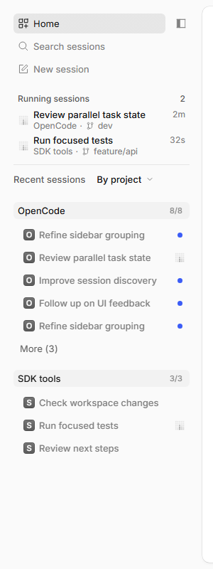

# OpenCode My

面向日常开发的桌面 AI 编程工作台。基于官方 OpenCode，保留完整的编程与智能体能力，重点优化使用界面、个性化流程和本地模型体验。

<p align="center">
  <picture>
    <source media="(prefers-color-scheme: dark)" srcset="docs/fork/dev-my/sidetab-overview-dark.png">
    
  </picture>
</p>
<p align="center"><sub>Side bar：运行中的任务、按项目分组的最近会话、分支与运行时长一屏可见。截图为合成数据。</sub></p>

Windows 测试版 [v2.2.3-dev-my.4](https://github.com/joe-ieta/opencode/releases/tag/v2.2.3-dev-my.4) 起，任务概览独立为第四种 Side bar；官方 Side tabs 保持原行为。首次人工测试已通过，上游 [Draft PR #60867](https://github.com/anomalyco/opencode/pull/60867) 等待设计审核。[设计与测试入口](docs/fork/dev-my/sidebar-mode.md)。稳定 Latest 仍为 `.3`。

## 项目定位

OpenCode My 把改动集中在每天都会用到的三件事上：

- **使用界面优化**：独立 Side bar 模式将首页、运行任务、最近会话和项目历史收进同一个侧栏。正在运行的任务即使没有打开标签也能看到，分支、工作树和运行时长随任务更新。
- **个性化流程定制**：最近会话默认按项目分组，每个项目默认显示 5 条并可展开；项目旁可直接新建会话。关闭标签或隐藏历史条目会保留会话，Home/搜索可重新打开。
- **本地使用偏好**：沿用系统语言与主题，记住标签布局、分组和排序偏好；项目、会话历史与配置保存在本机，使用本地模型不依赖额外的云端账户。

## 项目来源

OpenCode My 是 [anomalyco/opencode](https://github.com/anomalyco/opencode) 的 fork，跟踪官方 `dev` 分支，发行桌面应用 **OpenCode My**。

- 每次同步先合并官方 `dev`，再叠加本仓库尚未被上游接纳的界面与可靠性补丁。
- 编程、工具调用、子智能体、MCP 等核心能力随官方更新，不在 fork 中另起一套内核。
- 桌面使用独立的 GUI 身份和本 fork 的更新源；后台仍沿用官方 `dev` 的服务、配置和历史约定。
- 当前发行以 Windows x64 为主，Linux x64 提供 AppImage/deb；macOS 尚未提供本 fork 的构建验证。
- 维护分支、同步方法和发行记录见 [FORK.md](FORK.md) 与 [docs/fork](docs/fork/README.md)。

## 本地模型支持

本地模型沿用官方 provider 体系，不另造一套接口，配置和切换更直接：

- 统一走 OpenAI 兼容配置与本地模型发现，Ollama、LM Studio、vLLM、llama.cpp 等本地服务可按同一方式接入。
- 本地模型与云端模型共用模型选择、会话和工具流程，不为本地运行单独维护客户端。
- 修复自定义/本地模型因发布日期未知而被误判为旧模型并隐藏的问题；手动隐藏仍然优先。
- 不强制登录云端服务，模型地址、凭据和自定义模型配置留在本机，适合离线或内网开发。
- 本地模型仍受上下文长度、工具调用能力等自身限制；配置方法见[官方 Providers 文档](https://opencode.ai/v2/docs/providers)。

## 文档与发行

- [FORK.md](FORK.md)：fork 定位、三个维护分支和上游贡献状态
- [docs/fork](docs/fork/README.md)：维护、同步、验证、发布与 Qt/headless 资料
- [dev-my 桌面发行](docs/fork/dev-my/README.md)：Side bar、桌面身份、配置和运行时约定
- [Releases](https://github.com/joe-ieta/opencode/releases)：Windows/Linux 构建与历史版本

---

## 官方 OpenCode 首页

> 以下为上游 OpenCode 首页原文，随官方 `dev` 同步保留。

<p align="center">
  <a href="https://opencode.ai">
    <picture>
      <source srcset="packages/console/app/src/asset/logo-ornate-dark.svg" media="(prefers-color-scheme: dark)">
      <source srcset="packages/console/app/src/asset/logo-ornate-light.svg" media="(prefers-color-scheme: light)">
      
    </picture>
  </a>
</p>
<p align="center">The open source AI coding agent.</p>
<p align="center">
  <a href="https://opencode.ai/discord"></a>
  <a href="https://www.npmjs.com/package/@opencode/cli"></a>
  <a href="https://github.com/anomalyco/opencode/actions/workflows/release.yml"></a>
</p>

<p align="center">
  <a href="README.md">English</a> |
  <a href="README.zh.md">简体中文</a> |
  <a href="README.zht.md">繁體中文</a> |
  <a href="README.ko.md">한국어</a> |
  <a href="README.de.md">Deutsch</a> |
  <a href="README.es.md">Español</a> |
  <a href="README.fr.md">Français</a> |
  <a href="README.it.md">Italiano</a> |
  <a href="README.da.md">Dansk</a> |
  <a href="README.ja.md">日本語</a> |
  <a href="README.pl.md">Polski</a> |
  <a href="README.ru.md">Русский</a> |
  <a href="README.bs.md">Bosanski</a> |
  <a href="README.ar.md">العربية</a> |
  <a href="README.no.md">Norsk</a> |
  <a href="README.br.md">Português (Brasil)</a> |
  <a href="README.th.md">ไทย</a> |
  <a href="README.tr.md">Türkçe</a> |
  <a href="README.uk.md">Українська</a> |
  <a href="README.bn.md">বাংলা</a> |
  <a href="README.gr.md">Ελληνικά</a> |
  <a href="README.vi.md">Tiếng Việt</a>
</p>

[](https://opencode.ai)

---

### Installation

```bash
# YOLO
curl -fsSL https://opencode.ai/v2/install | bash

# Package managers
npm i -g @opencode/cli@latest      # or bun/pnpm/yarn
brew install anomalyco/tap/opencode-v2 # macOS and Linux (recommended, always up to date)
brew install opencode              # macOS and Linux (official brew formula, updated less)
sudo pacman -S opencode            # Arch Linux (Stable)
paru -S opencode-beta              # Arch Linux (Latest from AUR)
mise use -g opencode               # Any OS
nix run github:anomalyco/opencode  # Nix
```

> [!TIP]
> Remove versions older than 0.1.x before installing.

### Desktop App (BETA)

OpenCode is also available as a desktop application. Download it from [opencode.ai/download](https://opencode.ai/download).

| Platform              | Download                         |
| --------------------- | -------------------------------- |
| macOS (Apple Silicon) | `opencode-desktop-mac-arm64.dmg` |
| macOS (Intel)         | `opencode-desktop-mac-x64.dmg`   |
| Windows               | `opencode-desktop-win-x64.exe`   |
| Linux                 | `.deb`, `.rpm`, or `.AppImage`   |

```bash
# macOS (Homebrew)
brew install --cask opencode-desktop
```

#### Installation Directory

The install script installs OpenCode to `$HOME/.opencode/bin`.

### Agents

OpenCode includes two built-in agents you can switch between with the `Tab` key.

- **build** - Default, full-access agent for development work
- **plan** - Read-only agent for analysis and code exploration
  - Denies file edits by default
  - Asks permission before running bash commands
  - Ideal for exploring unfamiliar codebases or planning changes

Also included is a **general** subagent for complex searches and multistep tasks.
This is used internally and can be invoked using `@general` in messages.

Learn more about [agents](https://opencode.ai/v2/docs/agents).

### Documentation

For more info on how to configure OpenCode, [**head over to our docs**](https://opencode.ai/v2/docs).

### Contributing

If you're interested in contributing to OpenCode, please read our [contributing docs](./CONTRIBUTING.md) before submitting a pull request.

### Building on OpenCode

If you are working on a project that's related to OpenCode and is using "opencode" as part of its name, for example "opencode-dashboard" or "opencode-mobile", please add a note to your README to clarify that it is not built by the OpenCode team and is not affiliated with us in any way.

---

**Join our community** [Discord](https://discord.gg/opencode) | [X.com](https://x.com/opencode)
