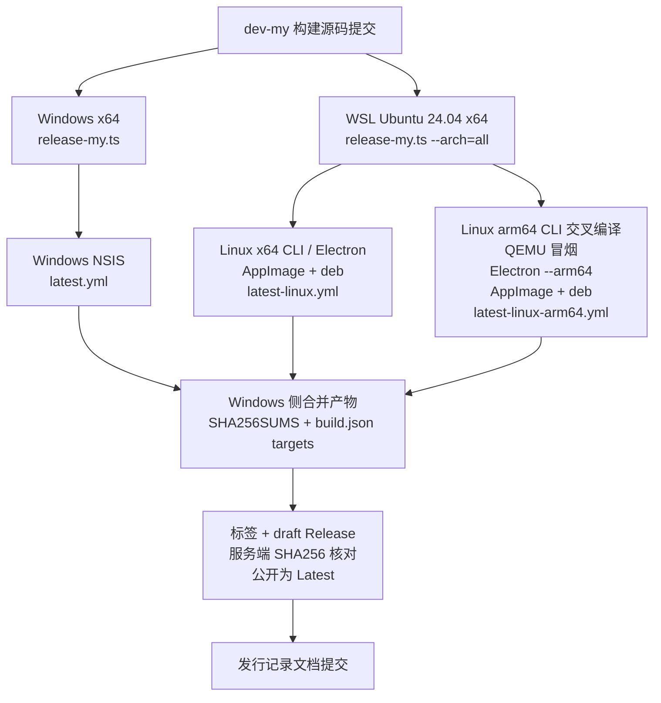

# 发布环境与多架构构建 KB

> 适用基线：`v2.2.3-dev-my.3`，2026-10-31。  
> 实测环境：Windows 11 x64 + WSL2 Ubuntu 24.04.1 LTS；发布目标为 Windows x64 与 Ubuntu amd64/arm64。  
> 本文面向需要复现 OpenCode My 发布环境的维护者。实际发行记录与哈希以 [dev-my 发行记录](../dev-my/releases.md) 为准。

## 1. 需求定义

### 1.1 发布目标

| 目标     | 约定                                                                                     |
| -------- | ---------------------------------------------------------------------------------------- |
| Windows  | x64 NSIS 安装包，`opencode-desktop-win-x64.exe`                                          |
| Ubuntu   | 24.04 LTS 为验证基线，amd64/arm64 的 AppImage 与 deb                                     |
| 更新清单 | Windows `latest.yml`；Linux x64 `latest-linux.yml`；Linux arm64 `latest-linux-arm64.yml` |
| 校验     | `SHA256SUMS`、`build.json`，以及 GitHub 服务端资产 SHA256                                |
| 源码溯源 | `build.json.commit` 必须等于待打标签的源码提交                                           |
| 发布形态 | 同一 Release 同时包含 Windows 与 Ubuntu 双架构，未签名                                   |
| 不在范围 | macOS、Windows arm64、官方签名/公证、自动覆盖升级                                        |

### 1.2 功能需求

1. 从 `dev-my` 干净工作区构建，使用根 `package.json` 锁定的 Bun 版本（当前 `bun@1.4.4`）。
2. Windows 与 Linux 使用同一个源码提交；先完成构建和验收，再打不可变版本标签。
3. Linux 支持 `x64`、`arm64` 或一次构建两者；arm64 允许在 x64 Ubuntu 上交叉构建。
4. 每个架构的 AppImage/deb、更新清单、CLI 与 ASAR 版本、原生架构可核对。
5. 发布资产只包含实际构建并验收的平台；不把未构建的平台写成通过。
6. 打标签后单独提交发行记录文档，不用文档提交冒充构建来源。

### 1.3 非功能需求

| 项目 | 建议                                                                                            |
| ---- | ----------------------------------------------------------------------------------------------- |
| 主机 | Windows 10/11 x64，启用 WSL2；6 核以上、16 GB 以上内存                                          |
| 磁盘 | 系统盘至少 10 GB 空闲；WSL VHDX 建议放在 D:/E: 等数据盘；构建与产物约需 8–10 GB                 |
| 网络 | 可访问 GitHub、npm、models.dev；GitHub Release 资产下载/上传正常                                |
| 时间 | 首次环境准备 30–60 分钟；Windows 构建约 5–10 分钟；Linux x64+arm64 约 20–40 分钟；上传约 1.5 GB |
| 账号 | GitHub CLI 已登录，具备目标仓库 release 权限；Git remote 可推送分支和标签                       |
| 安全 | 产物未签名；代理、Token、证书不写入仓库或文档                                                   |

## 2. 实测环境清单

| 项目           | 实测值                                                                                                 |
| -------------- | ------------------------------------------------------------------------------------------------------ |
| Windows        | Windows 11 专业版，Build 26200，x64                                                                    |
| CPU / 内存     | i7-9750H，6 核 12 线程；32 GB                                                                          |
| WSL            | WSL 2.7.8；Ubuntu 24.04.1 LTS，x86_64，systemd，12 vCPU / 15 GiB                                       |
| Bun            | 1.4.4（与 `packageManager` 一致）                                                                      |
| Node           | 24.22.2（用于 oxlint TypeScript 插件；Node 18 太旧）                                                   |
| Git            | 2.43.0                                                                                                 |
| 交叉工具       | `qemu-user-static`、`binfmt-support`、`libc6-dev-arm64-cross`                                          |
| Linux 打包     | `build-essential`、`fakeroot`、`unzip`、`dpkg-deb`、`mksquashfs`；`libfuse2t64` 仅运行 AppImage 时需要 |
| binfmt         | `/proc/sys/fs/binfmt_misc/qemu-aarch64`，解释器 `/usr/libexec/qemu-binfmt/aarch64-binfmt-P`            |
| ARM64 运行前缀 | `QEMU_LD_PREFIX=/usr/aarch64-linux-gnu`                                                                |
| WSL 磁盘       | VHDX 位于 `D:\WSL\Ubuntu`                                                                              |
| 代理           | Windows `127.0.0.1:17891`；WSL NAT 网关 `172.20.16.1` 的同一端口                                       |

> 代理端口和网关因机器而异，不要把本文示例直接复制到其他环境。

## 3. 构建方案总览



### 3.1 构建阶段

`packages/desktop/script/release-my.ts` 复用官方构建脚本，按以下阶段执行：

1. 更新内置模型目录。
2. 按目标架构构建 baseline CLI：x64 使用 `-baseline`，arm64 使用 `linux-arm64`（arm64 没有 baseline 变体）。
3. 校验 CLI 版本、模型目录；执行 CLI 冒烟。
4. 构建 Electron；Windows 先生成 app 再包 NSIS，Linux 打包 AppImage/deb。
5. 生成按架构的更新清单、`SHA256SUMS` 和 `build.json`。

### 3.2 多架构参数

```bash
# 当前主机架构
bun run release:desktop:my --version=<version>-dev-my.<N>

# 只构建 arm64
bun run release:desktop:my --version=<version>-dev-my.<N> --arch=arm64

# 同一标签同时构建 x64 与 arm64（推荐 Linux 发行）
bun run release:desktop:my --version=<version>-dev-my.<N> --arch=all
```

- `--arch` 省略时使用 `process.arch`。
- Windows 目前只允许 x64。
- `--arch=all` 会先清理输出目录，避免混入上一次构建的残留。
- 跨架构构建在开始前检查 `qemu-aarch64`/`qemu-x86_64` binfmt；缺失时立即失败并给出提示。
- 跨架构模型目录冒烟自动使用 `catalog-smoke --via-server`，避免 QEMU 下 5 秒插件激活超时。

### 3.3 双架构依赖

Linux 交叉构建前安装双架构可选依赖：

```bash
bun install --frozen-lockfile --cpu=*
```

`--cpu=*` 会安装 Linux x64 与 arm64 的 node-pty 等可选原生包。桌面打包配置会按目标架构过滤 node-pty 变体；不安装时 arm64 包可能缺少 `pty.node`。

## 4. 从零准备环境

### 4.1 Windows 侧

1. 确认 WSL2 可用：`wsl --status`、`wsl -l -v`。
2. 安装 GitHub CLI 并登录：`gh auth status`。
3. 配置 Git 身份；确认 `origin`（当前为 Gitee 镜像）和 GitHub 推送方式。
4. 确保系统盘有足够空间；WSL VHDX 建议放到数据盘。

本机 GitHub 推送使用临时凭据 helper，不写入全局配置：

```powershell
git -c credential.helper= -c credential.helper='!gh auth git-credential' push https://github.com/joe-ieta/opencode.git refs/heads/dev-my
```

### 4.2 Ubuntu WSL 安装与迁移

```powershell
wsl --install -d Ubuntu-24.04
wsl --shutdown
New-Item -ItemType Directory -Force D:\WSL | Out-Null
wsl --manage Ubuntu --move D:\WSL\Ubuntu
```

本机实际执行 `--move` 时返回 `Wsl/Service/MoveDistro/E_ACCESSDENIED`，但 VHDX 已复制到目标目录，注册表 `BasePath` 仍指向旧路径，导致 WSL 无法启动。处理方式：

```powershell
$root = 'HKCU:\Software\Microsoft\Windows\CurrentVersion\Lxss'
Get-ChildItem $root | ForEach-Object {
  $p = Get-ItemProperty $_.PSPath
  [pscustomobject]@{ Key = $_.PSChildName; Name = $p.DistributionName; BasePath = $p.BasePath }
}
# 找到 Ubuntu 的 Key 后，将 BasePath 改为 D:\WSL\Ubuntu
Set-ItemProperty 'HKCU:\Software\Microsoft\Windows\CurrentVersion\Lxss\<Ubuntu-Key>' -Name BasePath -Value 'D:\WSL\Ubuntu'
```

修改注册表前先关闭 WSL，并确认 VHDX 已完整复制。更稳妥的替代方案是导出再导入：

```powershell
wsl --export Ubuntu D:\WSL\ubuntu.tar
wsl --unregister Ubuntu
wsl --import Ubuntu D:\WSL\Ubuntu D:\WSL\ubuntu.tar --version 2
```

导入后需按需恢复默认用户；不要在有未备份数据时执行 `--unregister`。

### 4.3 Ubuntu 依赖

```bash
sudo apt update
sudo apt install -y build-essential fakeroot unzip curl \
  qemu-user-static binfmt-support libc6-dev-arm64-cross libfuse2t64

# Node 24：oxlint 的 TypeScript 插件需要 Node 22.18+ 的类型擦除能力
curl -fsSL https://deb.nodesource.com/setup_24.x | sudo bash -
sudo apt install -y nodejs

# 锁定 Bun 版本
curl -fsSL https://bun.sh/install | bash -s "bun-v1.4.4"
export PATH="$HOME/.bun/bin:$PATH"
bun --version   # 1.4.4
```

`rpmbuild` 只有追加 rpm 目标时才需要；Ubuntu 默认构建 AppImage 和 deb，不安装 rpm 不影响发行。

### 4.4 ARM64 binfmt 与 sysroot

WSL 的 `systemd-binfmt.service` 带有 `ConditionVirtualization=!wsl`，在 WSL 中不会启动，因此需要单独注册：

```bash
sudo sh -c 'test -e /proc/sys/fs/binfmt_misc/qemu-aarch64 || \
  cat /usr/lib/binfmt.d/qemu-aarch64.conf > /proc/sys/fs/binfmt_misc/register'
```

重启 WSL 后注册会丢失。可创建一个 oneshot 服务持久化：

```ini
# /etc/systemd/system/qemu-aarch64-binfmt.service
[Unit]
Description=Register qemu-aarch64 binfmt for WSL cross-builds
After=systemd-binfmt.service
ConditionPathExists=/usr/lib/binfmt.d/qemu-aarch64.conf

[Service]
Type=oneshot
ExecStart=/bin/sh -c 'test -e /proc/sys/fs/binfmt_misc/qemu-aarch64 || cat /usr/lib/binfmt.d/qemu-aarch64.conf > /proc/sys/fs/binfmt_misc/register'
RemainAfterExit=yes

[Install]
WantedBy=multi-user.target
```

```bash
sudo systemctl daemon-reload
sudo systemctl enable --now qemu-aarch64-binfmt.service
cat /proc/sys/fs/binfmt_misc/qemu-aarch64
```

设置交叉 glibc 前缀：

```bash
export QEMU_LD_PREFIX=/usr/aarch64-linux-gnu
```

缺少该前缀时，Bun arm64 二进制会报：

```text
Could not open '/lib/ld-linux-aarch64.so.1': No such file or directory
```

快速验证交叉编译与执行：

```bash
printf 'console.log("arm64 ok")\n' > /tmp/arm64-test.js
bun build --compile --target=bun-linux-arm64 /tmp/arm64-test.js --outfile /tmp/arm64-test
QEMU_LD_PREFIX=/usr/aarch64-linux-gnu /tmp/arm64-test
```

### 4.5 WSL 网络与代理

Windows 代理监听 `127.0.0.1:<port>` 时，WSL NAT 不能直接使用 `localhost`。找到默认网关并设置代理：

```bash
gateway=$(ip route | awk '/^default/ { print $3; exit }')
export HTTPS_PROXY="http://$gateway:<port>"
export HTTP_PROXY="$HTTPS_PROXY"
```

验证 GitHub、npm 和 Release 资产下载；Release 资产（`release-assets.githubusercontent.com`）是 Electron/Bun 交叉编译下载的关键路径：

```bash
curl -fsSI https://github.com
curl -fsSI https://registry.npmjs.org
curl -fsSI https://github.com/oven-sh/bun/releases/download/bun-v1.4.4/bun-linux-aarch64.zip
```

代理值属于本机环境，不写入仓库。

### 4.6 克隆与检查

```bash
git clone --branch dev-my https://gitee.com/ieta/opencode-my.git ~/opencode-my
cd ~/opencode-my
git config user.name frank
git config user.email 48937772+joe-ieta@users.noreply.github.com
bun install --frozen-lockfile --cpu=*
bun run check
```

不要在 `/mnt/e/AgentDev/opencode-my` 直接构建：WSL 下该目录会因 CRLF/autocrlf 差异显示数千个“已修改”文件，且 9p 文件系统较慢。使用 WSL ext4 中的独立克隆。

## 5. 构建步骤

### 5.1 Windows x64

```powershell
bun install --frozen-lockfile
bun run check
bun run release:desktop:my --version=<version>-dev-my.<N>
```

产物：`dist/releases/v<version>/`，包含 NSIS 安装包、`latest.yml`、单架构 `SHA256SUMS` 和 `build.json`。

### 5.2 Ubuntu x64 + arm64

```bash
export PATH="$HOME/.bun/bin:$PATH"
export QEMU_LD_PREFIX=/usr/aarch64-linux-gnu
export HTTPS_PROXY="http://<wsl-gateway>:<port>"
export HTTP_PROXY="$HTTPS_PROXY"

cd ~/opencode-my
bun run release:desktop:my --version=<version>-dev-my.<N> --arch=all
```

产物：

- `opencode-desktop-linux-x86_64.AppImage`
- `opencode-desktop-linux-amd64.deb`
- `opencode-desktop-linux-arm64.AppImage`
- `opencode-desktop-linux-arm64.deb`
- `latest-linux.yml`
- `latest-linux-arm64.yml`
- 单次构建的 `SHA256SUMS`、`build.json`（targets 为 `linux-x64` 与 `linux-arm64`）

### 5.3 合并 Windows 与 Linux 产物

Windows 和 Linux 在不同文件系统构建，需要把 Linux 产物复制到 Windows 输出目录，再合并校验信息：

1. 保留 Windows 的 `latest.yml`、安装包。
2. 复制 Linux 的 4 个安装包和两个 `latest-linux*.yml`。
3. 对 5 个安装包重新计算 `SHA256SUMS`。
4. 将 `build.json` 更新为：

```json
{
  "target": "windows-x64+linux-x64+linux-arm64",
  "targets": ["windows-x64", "linux-x64", "linux-arm64"]
}
```

5. 保留原 `version`、`tag`、`commit`、`channel`、`bun`、`signed`、`appId`、`updateUrl`。

> 不要分别运行 x64 和 arm64 后直接覆盖 `build.json`/`SHA256SUMS`。使用 `--arch=all` 一次性生成 Linux 双架构，再与 Windows 手动合并。

## 6. 验证清单

### 6.1 通用

- [ ] `bun install --frozen-lockfile` 成功；交叉构建另加 `--cpu=*`。
- [ ] `bun run check` 通过（当前 35/35）。
- [ ] `build.json.commit` 等于待打标签提交。
- [ ] 版本号是尚未发布的新迭代，未复用标签。

### 6.2 Windows

- [ ] 安装包 `VersionInfo` 为产品名 `OpenCode My`、版本 `<version>`。
- [ ] ASAR 内 `package.json` 版本正确。
- [ ] `resources/opencode-cli.exe --version` 为 `opencode v<version>`。
- [ ] `latest.yml` 的 SHA512、大小与安装包一致。
- [ ] 7-Zip 完整性检查通过。

### 6.3 Ubuntu

- [ ] x64/arm64 CLI `--version` 正确。
- [ ] 模型目录冒烟通过；arm64 在 QEMU 下使用 `--via-server`。
- [ ] desktop CLI 冒烟通过：`service.json` 发现、V1 升级确认、迁移历史。
- [ ] 两个 AppImage 的 ELF 架构分别为 x86-64 与 ARM aarch64。
- [ ] deb 的 `Architecture` 分别为 `amd64` 与 `arm64`；`Depends` 适合 Ubuntu 24.04。
- [ ] ASAR 版本、桌面文件 `Exec/Icon/StartupWMClass`、metainfo id 正确。
- [ ] `latest-linux.yml` / `latest-linux-arm64.yml` 的 SHA512、大小与对应文件一致。
- [ ] `SHA256SUMS` 覆盖全部 5 个安装包。

### 6.4 发布后

- [ ] GitHub Release 的 10 个资产大小与 SHA256 和本地一致。
- [ ] `draft=false`、`prerelease=false`，Latest 指向预期版本。
- [ ] 公开下载 `latest-linux-arm64.yml` 和至少一个安装包成功。

## 7. 发布流程

```powershell
# 1. 用 build.json 的源码提交打标签；标签对象指向构建来源
git tag -a v<version> <build.json commit> -m 'OpenCode My <version>'
git push origin dev-my
git push origin refs/tags/v<version>
# 本机 origin 为 Gitee 镜像；GitHub 发行仓库需单独推送标签
git -c credential.helper= -c credential.helper='!gh auth git-credential' push https://github.com/joe-ieta/opencode.git refs/tags/v<version>

# 2. 创建 draft，上传全部 10 个资产
gh release create v<version> <assets...> --repo joe-ieta/opencode --verify-tag --draft `
  --title 'OpenCode My <version> (Windows amd64 + Ubuntu amd64/arm64)' `
  --notes-file <release-notes.md>

# 3. 核对服务端大小与 SHA256 后再公开
gh release edit v<version> --repo joe-ieta/opencode --draft=false --prerelease=false --latest

# 4. 单独提交发行记录文档，不改变已发布标签
git add FORK.md docs/fork/dev-my docs/fork/maintenance.md
git commit -m 'docs: record <version> release'
```

标签不可变。发现构建问题时创建新的 `.N` 迭代，不覆盖已发布标签或资产。

## 8. 经验与坑

| 经验                                 | 说明                                                                           |
| ------------------------------------ | ------------------------------------------------------------------------------ |
| WSL 迁移可能只迁移磁盘不改注册表     | `--move` 报 `E_ACCESSDENIED` 后检查 `Lxss` 的 `BasePath`；或改用 export/import |
| WSL 不自动继承 localhost 代理        | 用 `ip route` 网关加代理端口，确认 Release 资产可下载                          |
| WSL 不启动 systemd-binfmt            | `ConditionVirtualization=!wsl`；需要手动注册或 oneshot 服务                    |
| 动态 arm64 程序需要 sysroot          | 安装 `libc6-dev-arm64-cross`，设置 `QEMU_LD_PREFIX`                            |
| QEMU 下插件激活可能超过 5 秒         | `catalog-smoke --via-server` 通过预启动服务并重试；GUI 仍需原生验证            |
| Linux arm64 的更新清单名不同         | electron-builder 生成 `latest-linux-arm64.yml`，不能复制成 `latest-linux.yml`  |
| arm64 没有 baseline                  | `--baseline` 只用于 x64；`OPENCODE_TARGET=linux-arm64`                         |
| 交叉构建需要双架构可选依赖           | `bun install --frozen-lockfile --cpu=*`，否则缺少 arm64 node-pty               |
| 不要从 `/mnt/e` 构建                 | CRLF 与 9p 文件系统导致工作区“已修改”和性能问题                                |
| Node 版本影响 oxlint                 | Node 22.16 需 `NODE_OPTIONS=--experimental-strip-types`；Node 24 更简单        |
| WSL VHDX 默认在系统盘                | 构建会增长数 GB；提前迁移到 D:/E:，并保留 10 GB 以上空间                       |
| Windows 和 Linux 产物需合并          | 单次脚本只构建一个平台；用 `--arch=all` 出 Linux 双架构后手工合并              |
| 服务端校验不能省                     | 上传后逐项比对大小与 SHA256，再 `draft=false`                                  |
| 不要运行 `OpenCode My.exe --version` | 会尝试启动 GUI；改为检查 ASAR/CLI 版本                                         |
| 未签名是已知限制                     | 不承诺自动更新或系统级安装体验；文档明确说明                                   |

## 9. 常见故障

| 现象                                                                  | 原因                                        | 处理                                                           |
| --------------------------------------------------------------------- | ------------------------------------------- | -------------------------------------------------------------- |
| `cannot execute binary file: Exec format error`                       | binfmt 未注册或 WSL 重启后丢失              | 注册 `qemu-aarch64`，启用 oneshot 服务                         |
| `Could not open '/lib/ld-linux-aarch64.so.1'`                         | 缺少 arm64 glibc 或未设 `QEMU_LD_PREFIX`    | 安装 `libc6-dev-arm64-cross`，导出 `QEMU_LD_PREFIX`            |
| `ServiceUnavailableError: Location plugins did not finish activating` | QEMU 下插件激活超过 5 秒                    | 使用 `catalog-smoke --via-server`；GUI 用原生 arm64            |
| `Missing Linux update manifest`                                       | 错把 arm64 清单当 `latest-linux.yml`        | 使用 `latest-linux-arm64.yml`                                  |
| arm64 包缺少 `pty.node`                                               | 未安装双架构可选依赖                        | `bun install --frozen-lockfile --cpu=*`                        |
| `Unknown file extension ".ts"`（oxlint）                              | Node 太旧，无法加载 TS 插件                 | 安装 Node 24，或设置 `NODE_OPTIONS=--experimental-strip-types` |
| WSL 无法启动，`ERROR_FILE_NOT_FOUND`                                  | VHDX 已移动但 `BasePath` 未更新             | 修正注册表或 export/import                                     |
| GitHub Release 下载超时                                               | WSL 未走代理，或代理未允许 Release 资产域名 | 使用 WSL 网关代理并测试 `release-assets.githubusercontent.com` |
| `bun install` 出现 patch 不再适用警告                                 | lockfile 中已有依赖演进                     | 与构建失败区分；不要仅凭警告改 lockfile                        |
| 磁盘空间不足                                                          | WSL VHDX 在系统盘增长                       | 迁移 VHDX，清理 `.cache`/`dist` 后重建                         |

## 10. 复现验收标准

满足以下条件，视为发布环境可用：

1. 干净克隆 `dev-my`，Bun 版本与 `packageManager` 一致。
2. `bun run check` 在 Windows 与 WSL 均为 35/35。
3. Windows 可生成 NSIS 安装包；Linux 可用 `--arch=all` 生成 x64/arm64 AppImage 与 deb。
4. x64 与 arm64 的 CLI 模型目录冒烟、desktop CLI 冒烟通过。
5. 5 个安装包的架构、版本、清单、`SHA256SUMS` 和 `build.json` 一致。
6. GitHub Release 的 10 个资产服务端大小与 SHA256 全部匹配。
7. 发行记录写明源码提交、标签、构建环境、验证范围、未验证项和哈希。

## 11. 参考

- [维护、同步、验证与发布](../maintenance.md)
- [dev-my 桌面发行与运行时约定](../dev-my/README.md)
- [dev-my 发行记录](../dev-my/releases.md)
- [release-my.ts](../../../packages/desktop/script/release-my.ts)
- [catalog-smoke.ts](../../../packages/cli/script/catalog-smoke.ts)
- [官方 release workflow](../../../.github/workflows/release.yml)
- [官方 release 脚本目录](../../../.github/release/)
