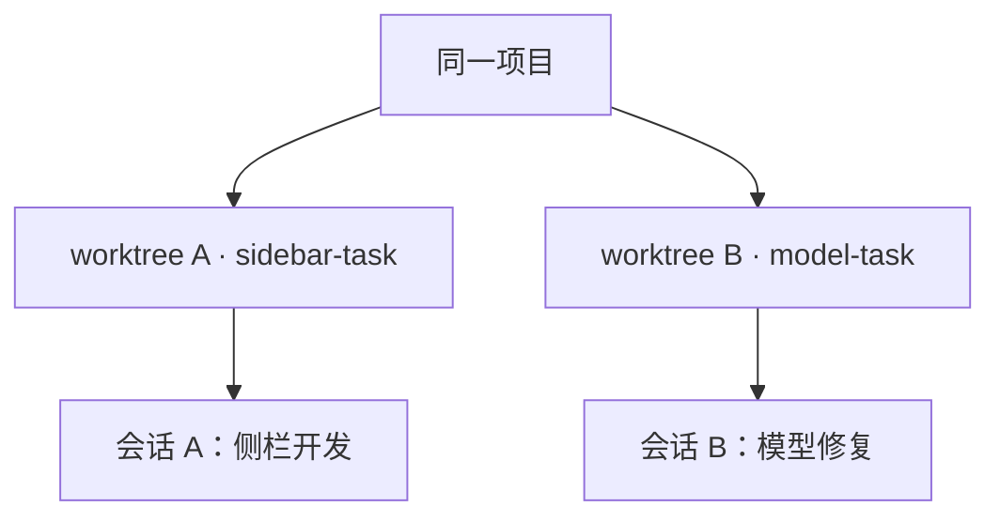

# OpenCode V2：worktree 与多任务并行

> 适用基线：`v2.2.2-dev-my.1`，2026-10-30。本文描述当前实现；本 fork 的 Side tabs 提供任务观察视图，底层工作区与调度机制沿用 V2。

**核心模式：worktree 隔离代码，会话调度器协调执行，Git 分支保存和整合成果。**

## 四个概念

| 概念            | 职责与关系                                                                     |
| --------------- | ------------------------------------------------------------------------------ |
| 项目 Project    | 组织工程、工作目录和会话；一个项目可以包含多个 worktree                        |
| 分支 Branch     | 指向提交历史，本身不提供独立文件目录                                           |
| 工作树 Worktree | 实际可读写的目录，拥有自己的工作文件、暂存区和 HEAD                            |
| 会话 Session    | 保存对话、输入和执行状态，通过 Location 绑定工作目录；一个目录可以承载多个会话 |

Git worktree 共享仓库的提交对象、分支和标签，各目录的文件修改相互隔离。**会话绑定目录，不锁定某个分支**：外部切换该目录的分支后，会话使用的代码也随之变化。

## 并行执行的设计

1. **按工作区隔离文件。**新会话可使用主目录、已有 worktree，或新建 worktree。内置 Git 策略实际调用 `git worktree add --detach <目录> <起点>`；分支选择用于指定起点，不自动创建命名任务分支。长期任务可在其目录中显式创建分支。
2. **同会话串行，不同会话并发。**后台按 Session ID 协调执行；同一会话的输入排队或在适当边界引导执行，重复唤醒会合并，不同会话可以同时运行。当前协调机制主要位于单个服务进程内。
3. **按 Location 解析执行环境。**输入先持久化，再安排执行；运行时按会话位置取得工具、配置等服务。界面从会话与事件状态形成首页、Recent sessions、Running sessions 等视图。

典型安排是“一个独立修改任务一个 worktree，并配一个任务分支”，完成后审查、测试，再合入集成分支。命名分支可按下面的示意显式创建：

## 非 Git 项目

普通目录仍可作为项目打开，执行读写文件、工具调用和多个并发会话，但没有 Git 分支与内置 Git worktree 隔离。当前标准界面主要对 Git 项目开放工作区选择，**不会自动改用目录复制**。

无 Git 时，同一目录里的多个会话共享文件。手工复制成多个目录可以隔离文件，但通常按不同项目识别，也没有自动的版本合并关系。

服务端提供可替换的 worktree 策略接口，插件可以实现其他本地工作区机制；这不等于当前标准界面已经提供完整的非 Git 隔离流程。

## 使用边界

- 新会话、新标签页不等于新分支或独立工作区；两个会话使用同一目录时，仍可能同时修改同一文件。
- worktree 隔离工作文件，端口、外部数据库等资源仍需分别安排；未跟踪的环境文件和依赖需要各目录自行准备。
- Running sessions 展示执行状态；关闭标签或隐藏侧栏条目不等于停止任务，需使用明确的停止操作。
- Git 提交、审查、合并及工作区清理仍是独立步骤，不能用会话完成状态替代。

## 实现依据

- [会话与 Location](../../../packages/schema/src/session.ts)、[Location 定义](../../../packages/schema/src/location.ts)
- [Git worktree 创建](../../../packages/core/src/git.ts)、[工作区策略接口](../../../packages/core/src/worktree/strategies.ts)
- [按会话协调执行](../../../packages/core/src/session/run-coordinator.ts)
- [普通目录项目识别](../../../packages/core/src/project.ts)、[界面 Git 项目入口](../../../packages/app/src/new-session/location/dialog.tsx)

返回 [fork 文档索引](../README.md)。
