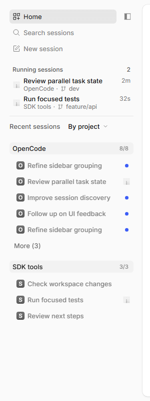

# dev-my：V2 桌面发行线

## 定位与当前进度

跟随官方 `upstream/dev`，在本仓库 `origin/dev-my` 维护，发行完整 OpenCode My 桌面应用，并保留本仓库尚未被上游接纳的功能和修复。它不用于替代两条 Qt/headless 内核发行线。

- 2026-11-14，源码基线已同步至 V2 2.3.0 的 `dev@f0089856c0`，合入 227 个上游提交，保留共享项目历史、独立 Side bar、Running、升级迁移及桌面发行补丁。`dev-my` 是桌面维护主线，远端 `sidebar-mode` 保留为 PR 来源引用。二进制与源码同步记录见 [releases.md](releases.md)。
- 2026-11-14，将 `dev-my` 合入 `dev-my-models` 后发布 Windows x64 测试预发行 [v2.3.0-my.2](https://github.com/joe-ieta/opencode/releases/tag/v2.3.0-my.2)，构建源码 `4060cf9bab`。本版在模型选择器中实现 Custom Provider 管理：新增/编辑全局 OpenAI Compatible provider、凭据存储、主动 `/models` 导入、原生元数据、最小文本测试和类型化高级字段。完整检查、8/8 浏览器回归及安装包核验通过；人工安装验收待本地验证，Latest 仍为 `v2.2.6-my.1`。
- 最新正式发行 [v2.2.6-my.1](https://github.com/joe-ieta/opencode/releases/tag/v2.2.6-my.1) 提供 Windows x64 NSIS 和 Linux amd64、arm64 的 AppImage 与 deb，构建源码 `231de37312`。Windows 与 Linux 本地验证均已通过。
- 本版增加 Side bar 项目计数、固定区域下置与远程仓库提示，并合入官方会话已读菜单、侧面板恢复、Copilot Auto 和嵌入模型入口；继续复用共享项目缓存、会话索引与 Running 实现。
- 正式发行已设为 GitHub Latest。构建和验收结果见 [发行记录](releases.md)。
- Linux 在 Ubuntu 24.04.5 容器中构建，完整检查 34 项、两种架构各 7,676 个模型比对、CLI 迁移冒烟及四个安装包的解包检查均通过。ARM64 冒烟在 QEMU 中执行；2026-11-13 用户确认 Linux 本地验证通过。
- macOS 暂无本 fork 发行验证；`release-my.ts` 支持 Windows x64 与 Linux x64/arm64。Linux arm64 可在 Ubuntu 24.04 x64 上通过 `qemu-user-static`、`libc6-dev-arm64-cross` 和 binfmt 交叉构建及 CLI 冒烟，正式 ARM64 GUI 验收仍需原生 arm64。完整环境准备、构建和排障见 [发布环境与多架构构建](../KB/release-environment.md)。
- 历史正式版验证（`v2.2.3-dev-my.3`）：Windows 与 WSL Ubuntu 根检查均 35/35；Windows NSIS、ASAR/CLI 版本、7-Zip 完整性、`latest.yml` SHA512 通过；Linux x64/arm64 模型目录冒烟各 7,646 个模型，desktop CLI 冒烟均通过；两架构 ASAR/CLI、AppImage/deb 架构、deb 元数据、更新清单与 10 个资产的服务端 SHA256 均已核对。完整应用单元测试、browser 条件测试和 GUI 回归未在本轮重复运行；ARM64 GUI 尚未原生验收。详细结果见 [releases.md](releases.md)。

## 已维护的行为

### Side bar（本地独立模式）

界面设置保留官方 Top tabs（`horizontal`）、Side tabs（`vertical`）和 Inbox（`inbox`），新增本地 Side bar（`sidebar`）。官方 Side tabs 继续只显示已打开的标签，不加入项目分组、历史会话或 Running sessions 区域。

本地功能由独立的 `sidebar-sessions.tsx` 承载；`tab-strip.tsx` 恢复到已合入的官方 `dev@e7acf85bb7` 实现。仅 Side bar 使用扩展的 Home 项目清单，其余模式沿用官方本客户端已使用项目的展示规则。后台项目登记、会话和权限模型不变。

升级不会将已有 `vertical` 偏好自动改成 `sidebar`；需要在设置中选择 Side bar。原有分组、排序和隐藏状态继续保留，供新模式使用。以下截图和功能描述对应这一独立模式；已发布的 `.1` 至 `.3` 版本仍将这些功能放在 Side tabs 中。

独立模式首次 Windows 发行验证：根目录 `bun run check` 35/35；应用单元测试 945 项、browser 条件测试 303 项；最新生产构建的完整 Home/标签回归 63/63，设置与标签预览专项 4/4。四种模式切换、刷新后恢复偏好、官方 Home 的使用历史过滤、Side bar 分组/隐藏/排序以及 Running sessions 均已覆盖。后续 `.5` 核对语言测试 21/21、生产 Home/标签回归 65/65，29 个相关词条在非英语界面中仍采用英文回退。各平台构建与资产核验记录见 [发行记录](releases.md)。

  <picture>
    <source media="(prefers-color-scheme: dark)" srcset="sidetab-overview-dark.png">
    
  </picture>

Running sessions、按项目分组的最近会话、分支与运行时长。截图为合成数据。

Running sessions 独立展示运行任务，包含项目、所在工作目录的当前分支和紧凑运行时长。Recent sessions 与首页共享项目/会话历史，默认按最近操作排序；显式设置的排序继续生效。

Recent sessions 默认使用 By project 分组，已有偏好优先。按项目分组默认显示 5 条，超出可展开；项目标题可将整个分组收起为标题行，选择按服务器与规范化项目路径持久化，与原有 More/Show less 状态独立。普通 List 不受收起状态影响，Running sessions 始终保留；标题 `+` 新建时展开该项目。分组数量使用紧凑最近/总数表示，hint 展示更完整信息，线程 hint 包含可获得的最近运行时间。关闭侧栏条目只隐藏，不删除历史；搜索仍可找到，重新打开后恢复。真正删除会话需走删除操作。

旧 Side tabs PR #60446 已关闭，由独立模式的贡献稿 #60867 记录替代；贡献分支为 `sidebar-mode`，仅作历史参考，设计审核状态不改变本地 `dev-my` 主线。特性设计、需求检索与测试记录见 [Side bar 独立模式](sidebar-mode.md)。

多任务并行沿用官方 worktree 机制：同一工作目录里的会话共享代码和当前分支；独立 worktree 才隔离文件。新建 worktree 的分支选择是起点，内置 Git 策略默认 detached HEAD，不自动创建命名任务分支。Side bar 展示这些任务，不改变其 Git 归属。

`v2.2.2-dev-my.2` 的后续优化：线程 hint 按需读取所在工作目录的当前分支，并展示所属工作树路径；项目分组计数后可直接新建预选该项目的会话。Recent sessions 只列主会话，恢复的子智能体标签也不再作为独立历史行，子智能体仍从父会话进入，Running sessions 保留运行任务观察能力。Home 与侧栏均显示服务器项目历史，避免官方客户端与本 fork 的 GUI 本地状态独立导致 Home 缺项目；显式隐藏项目会被单独记忆，重新使用该项目后恢复显示。

### V1 升级与可靠性

保留单向 V1→V2 升级确认、迁移清理批次提交和恢复、SQLite 错误分类与 Layer 依赖诊断。迁移相关 PR 未合并前，不能因上游同步或 PR 关闭丢弃本地实现。

### 自定义模型

`%USERPROFILE%\.config\opencode\opencode.jsonc` 中的自定义模型可由后台读取。已修复的缺陷在界面日期转换：`released: 0` 被误转为 `1970-01-01`，进而隐藏。现在保留未知日期，使用现有默认可见规则；手动隐藏仍然优先。上游 #60496 已合并。

`dev-my-models` 的 Custom Provider 入口位于模型选择器（桌面、免费模型弹窗和移动抽屉）：可新建/编辑全局 OpenAI Compatible provider，Key 存凭据存储，用户主动拉取 `/models` 并勾选导入；支持 Ollama/LM Studio 原生元数据、最小文本测试、类型化超时/兼容/推理/计费/变体字段。配置编辑保留未动 JSONC，使用 revision 冲突检查；V1、项目、托管和继承定义只读。内置 Ollama/LM Studio/vLLM 的自动发现不重复实现。设计与验证见 [Custom Provider 设计](custom-provider.md)。

## 桌面身份、服务与配置

| 项目                | 约定                                                                                              |
| ------------------- | ------------------------------------------------------------------------------------------------- |
| 源码分支 / 版本后缀 | `dev-my` / `<V2版本>-my.<N>`                                                                      |
| 桌面产品名          | `OpenCode My`                                                                                     |
| 桌面 appId          | `ai.opencode.desktop.dev-my`                                                                      |
| 后台运行渠道        | **`dev`**，不能改成 `dev-my`                                                                      |
| 服务和历史          | 使用官方 dev 约定的 `service.json`、`opencode.db`；GUI 本地状态属于独立 appId                     |
| 更新来源            | 本 fork 对应 release tag 的 feed，不使用官方桌面更新源                                            |
| 下载与发布页        | 全部平台统一使用本仓库 GitHub Releases 的完整安装包与更新清单                                     |
| 自动更新限制        | 当前 feed 固定在当前 tag；后续 fork 版本需手动下载安装                                            |
| 构建产物            | `dist/releases/v<version>/`；Windows NSIS，Linux AppImage/deb，附更新清单、SHA256SUMS、build.json |

早期 `v2.2.0-dev-my.1` 曾误用自定义后台渠道，选择独立的服务注册和空历史库，导致桌面发现失败。后续版本修正了该约定；排查历史或配置缺失时，先核对正在运行的 CLI 路径、版本、服务注册和真实加载的配置，不要先改用户数据库或配置。

## 会话状态设计与计划

| 文档                                                     | 内容与进度                                                                             |
| -------------------------------------------------------- | -------------------------------------------------------------------------------------- |
| [会话当前目标与活动状态设计 v0.2](session-goal-state.md) | 总体设计前置：目标三态、活动两态，以原因补充说明；现有代码、issue 和 PR 分析收录在附录 |
| [开发任务计划 v0.2](session-goal-state-plan.md)          | 方案已确认；第一阶段已实施，人工验收后再推进目标评审                                   |
| [第一阶段验证记录](session-goal-state-validation.md)     | 活动来源、去重与分层扩展、自动检查结果、覆盖限制及人工验收项                           |

当前完成后台任务与子智能体的活动观测实现；G1 人工验收待确认，动态目标评审未开始。本轮未修改或新建 PR。

## 后续工作

- #60496 的最终合并实现与测试已随本次同步吸收，继续保持自定义模型可见性回归覆盖。
- dev-my 继续作为 Side bar 本地维护主线；sidebar-mode 仅同步 #60867 的上游贡献，保持官方 Side tabs 行为。按评审和人工测试反馈继续完善。
- 跟踪 #56929、#60084 和其他未被官方等价实现的可靠性补丁。
- 自定义模型配置界面已按 [Proposal](https://github.com/anomalyco/opencode/issues/33704#issuecomment-6515528622) 的方向在 `dev-my-models` 实现：模型选择器内新增/编辑全局 OpenAI Compatible provider，Key 进凭据存储，模型发现由用户主动触发；实现基于 V2 2.3.0 重验，Windows 测试发行待人工验证。设计与[源码评审记录](custom-provider-review.md)见 [Custom Provider 设计](custom-provider.md)。
- 长会话全貌显示已形成设计草案：[Session Overview](session-overview.md)。建议先以低风险的时间线预设和只读侧栏插件验证，不改主时间线投影与默认体验。

构建命令、提交与发布步骤见 [维护方法](../maintenance.md)，上游状态见 [PR 跟踪](../upstream-prs.md)。
