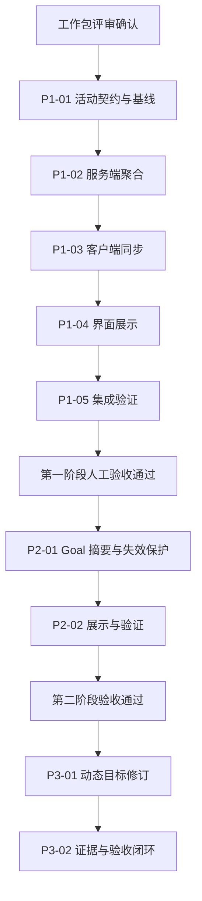

# 会话目标与活动状态开发任务计划

版本：**v0.2**。日期：2026-11-02。维护线：`dev-my`。对应设计：[会话当前目标与活动状态 v0.2](session-goal-state.md)。状态：**G0 已确认；第一阶段已实施，等待验收；第二、三阶段未开始**。

本计划将已认可的总体方向转为可逐项验收的开发任务。用户已确认方案与工作包并授权第一阶段实施；仅补齐活动观测，保持工具执行策略。G1 人工验收通过后再推进目标评审。实际分层、来源契约、验证结果与限制见 [第一阶段验证记录](session-goal-state-validation.md)。

## 交付顺序

第一阶段完成“当前活动”的可信观测，第二阶段复用 Goal 形成完成摘要，第三阶段补齐动态目标修订和验收关系。目标使用待判断、未达成、已达成三态；活动使用运行中、空闲两态。原因、连接可用性、已有暂停与执行结果作为辅助信息，不另建一组顶层状态。

| 顺序 | 工作包                     | 主要交付                                             | 前置依赖                       |
| ---- | -------------------------- | ---------------------------------------------------- | ------------------------------ |
| 1    | P1-01 活动契约与验证基线   | 来源与归属表、去重规则、重现用例、隔离环境及性能基线 | G0：工作包评审确认             |
| 2    | P1-02 服务端活动聚合       | 本会话及后代的活动快照、对应事件与归属               | P1-01                          |
| 3    | P1-03 客户端同步           | 共享活动数据、快照与事件合并、断线恢复               | P1-02                          |
| 4    | P1-04 会话与 Side bar 展示 | 后台与子智能体可见、定位与去重、活动文案             | P1-03                          |
| 5    | P1-05 第一阶段验证与交付   | 自动验证、人工验收材料、维护记录                     | P1-02、P1-03、P1-04            |
| 6    | P2-01 Goal 完成摘要        | 复用显式 Goal、证据入口、基本失效保护                | G1：第一阶段验证及人工验收通过 |
| 7    | P2-02 两种状态展示与验证   | 目标与活动组合展示、保守回退、评审开销核对           | P2-01                          |
| 8    | P3-01 动态目标修订         | steer/queue、目标版本、幂等与旧结论失效              | G2：目标评审基础验收通过       |
| 9    | P3-02 验收关联与动态闭环   | 任务/证据关联、人工确认、恢复场景与整体验收          | P3-01                          |

这是交付依赖顺序。各工作包同时编写必要的实现测试，P1-05 汇总验证和执行集成回归，不把全部测试推迟到最后。后续执行策略实验不在这条必经链上。

## 第一阶段：后台与子智能体观测

### P1-01 活动契约与验证基线

**目的：** 明确当前基线能观察哪些工作，以及如何把它们准确归属到会话。

工作内容：

- 确认实施时的 `dev-my` 提交、工作树差异、上游相关接口及适用 AGENTS/测试技能；文末附录的旧 PR 预检只作参考，不能直接当作实施基线。
- 列出模型执行、内置子智能体、shell、image、用户手动 shell 的来源、ID、所属 Session、父子关系、结束依据及可用事件；登记尚未接入的插件工作范围。
- 明确子 Session 与 subagent Job、Shell 与 Job 的同一工作去重关系；规定顶层摘要覆盖后代，而操作仍定位到实际所属会话或工作。
- 选择优先复用的快照和事件入口；只在现有协议不足时拟定最小 experimental 扩展，避免另建通用 Job 系统。
- 在隔离数据与服务中重现“父会话回复结束，后台 shell 或子智能体仍运行”；记录应用会话相关性能基线。

预期涉及范围：`packages/core/src/session`、`packages/core/src/job.ts`、`packages/protocol/src/groups`、`packages/client/src/solid/data.ts` 及应用会话数据层。此包以契约和重现记录为交付，具体接口名由现有能力决定。

**验收：** 每个纳入范围的来源有明确身份、归属、结束依据和验证场景；重复计数与重连方案可落实；明确记录覆盖限制、实现基线和性能结果。无需变更工具执行策略即可继续 P1-02。

### P1-02 服务端活动聚合

**目的：** 在模型空闲时，仍能准确查询会话家族中的运行工作。

工作内容：

- 基于当前执行与后台登记记录提供活动快照，按真实工作身份去重，并沿父子关系归集后代。
- 为开始、结束及归属变化提供客户端可消费的更新依据；先复用事件，缺失时增加必要的窄通知。
- 保留工作原有状态、输出入口和归属，派生摘要与计数；不重复持久化一套活动事实。
- 对结束、取消、会话删除和重启恢复重新计算活动；没有可靠运行证据时不能仅凭旧记录显示持续运行，也不能因尚未恢复而肯定显示空闲。
- 沿用当前查询权限与项目/会话作用域。公共 Protocol 或 Server HttpApi 如有变化，遵循 experimental 约定并在 `packages/client` 执行 `bun run generate`。

**验收：** 本会话后台 shell、后代执行和孙级 shell 均能从顶层活动查询发现；同一工作只计一次；结束后从运行集合移除且结果仍可访问；已有执行 API 与恢复契约保持原义。相关 Core/Protocol/Server 测试覆盖真实实现。

### P1-03 客户端快照与订阅同步

**目的：** 首次打开、实时运行和断线重连得到一致的活动状态。

工作内容：

- 在共享客户端数据层消费 P1-02 的事实，分别保留原有模型执行状态与新增的综合活动摘要，避免改变依赖执行状态的提交和中断逻辑。
- 正确处理加载快照期间到达的开始/结束事件、重复通知和已结束对象，沿用现有有序事件与同步机制。
- 首次同步或断线期间复用连接可用性提示，旧数据不能伪装为当前事实；重连后用权威快照校准。
- 按既有服务器/会话订阅边界复用查询，避免为每个侧栏行单独轮询或遍历全部历史。

**验收：** 只有后台工作的会话在重连后仍可见；快速结束不会被旧快照复活；多客户端结果一致；订阅解除后不继续刷新；原有发送、queue/steer 和执行控制不受影响。通过相应客户端测试与包 typecheck。

### P1-04 会话与 Side bar 展示

**目的：** 用户可以立即知道哪一个会话仍有工作，以及工作是什么。

工作内容：

- 接入会话行、顶层会话/项目摘要和 Side bar Running sessions；后台独自运行时继续出现，子智能体与后代工作能定位。
- 保留运行区常显、现有高度限制、列表与项目分组、项目收起/展开及既有子会话入口；同一工作不重复放大计数。
- 使用“运行中／空闲”与简短活动数量、主要原因；新增摘要不把 execution succeeded 或活动空闲解释为目标已达成。
- 综合活动只用于观测和展示，不使原有模型 Stop/Esc 自动获得停止所有后台工作的含义；沿用工作已有的操作入口。
- 维护官方模式的导航与布局，核对共享状态、英文来源与中文回退/翻译、减少动态效果及静止图标表达。

预期主要入口：`packages/app/src/shell/titlebar/active-sessions.tsx`、`sidebar-sessions.tsx`、`packages/app/src/shell/layout/project-avatar-state.ts` 与实际会话状态组件；以 P1-01 的源码核对为准。

**验收：** 父会话模型已结束但后台工作仍运行时，用户仍能在运行区定位；模型、子智能体和 shell 的数量与实际工作对应；所有工作结束后清除运行标识；现有模式、分组和动画偏好回归通过。

### P1-05 第一阶段验证与交付

**目的：** 证明观测修复有效，并确认工具行为没有随展示改变。

各实现包完成对应测试后，按以下场景执行集成验证：

| 场景                                                        | 预期结果                                                     |
| ----------------------------------------------------------- | ------------------------------------------------------------ |
| 父会话模型结束，仅 shell 运行                               | 活动仍运行，Running sessions 可定位                          |
| 子智能体执行、子智能体模型结束但其 shell 运行、孙级任务运行 | 顶层均可发现；子 Session/Job 不重复计数                      |
| 同一会话并行多个工作，先后或快速结束                        | 数量准确，最后一个结束后清除运行标识，无旧快照复活           |
| 退出码非零、取消、会话删除                                  | 活动按真实生命周期更新，结果/原因可追溯，不制造目标已达成    |
| 用户手动 shell 完成，通知采用 `resume: false`               | 状态可观测，模型不会因观测功能自动启动                       |
| 长期服务运行                                                | 持续可见且不会被观察逻辑超时终止；本阶段不判断它是否影响目标 |
| 冷启动、断线重连、服务重启                                  | 与当前权威事实一致，数据不完整时有同步提示                   |
| 后台独自运行时查看/操作会话                                 | 不借综合活动改变现有中断、发送或子智能体收尾策略             |
| 多项目、四种模式、分组折叠、减少动态效果                    | 原有功能保持有效，静止图标和文本仍可辨认活动                 |

实施前阅读匹配的 `.opencode/skills` 测试技能；运行受影响包的真实测试与 typecheck，必要时按仓库要求复核 `typecheck:tsc`，最后运行根目录 `bun run check`。按应用规范完成受影响的组件或 e2e 回归，与 P1-01 的性能基线比较。

交付实际代码提交范围、自动检查结果、剩余覆盖限制和人工验收步骤，并更新本目录记录。使用独立服务和数据完成故障/恢复测试；开发工作树本身不隔离正在使用的 dev 后台数据。需要测试安装包时走既有发行流程，记录版本和构建来源；此计划本身不发起发布或测试邀请。

**G1 验收门槛：** 自动检查和观测场景通过，人工确认后台与子智能体在真实使用中可见且准确，执行策略没有改变。未达到 G1 时只完善第一阶段，不提前推进动态目标功能。

## 第二阶段：复用 Goal 的完成摘要

### P2-01 Goal 摘要与基本失效保护

依赖 G1。在 experimental 开关下优先服务已有显式 Goal，复用目标来源、reviewer、idle hook、RPC/event 与证据规则，提供待判断、未达成、已达成的只读摘要。已有 `Goal.State.status` 保持其控制语义，不把 paused 简单映射成目标失败。

最小有效性保护必须在本阶段到位：新相关输入、未分类的 steer 或相关证据变化，使旧完成结论暂时失效；保存评审前再次核对输入/证据边界。新诉求尚未纳入时，即便旧目标的 reviewer 返回 done，也不能宣称当前整体目标达成。尚无可靠目标依据的普通会话保持待判断，不靠旧 execution outcome 补齐。

**验收：** 可以解释当前结论及其证据；评审期间新输入不会被旧 done 覆盖；观察不会启动自动续跑，暂停和预算继续有效。普通诉求的自动归纳与完整版本修订留给第三阶段。

### P2-02 两种状态展示与验证

依赖 P2-01。将目标摘要与第一阶段活动摘要组合展示，覆盖“未达成且空闲”“已达成但服务仍运行”等情况；等待、暂停和错误通过原因或已有控制信息解释。

**验收：** 目标与活动互不替代；首次加载、旧结论失效、reviewer 错误和缺失证据均保守呈现；打开或刷新侧栏不触发额外模型评审。记录评审次数、延迟及异常行为，完成必要检查和人工验收后达到 G2，再推进第三阶段。

## 第三阶段：动态目标与验收闭环

### P3-01 目标版本与输入采纳

依赖 G2。按照既有 admission/delivery 与 steer/queue 边界，支持普通诉求形成目标、补充约束修订版本、切换任务创建新目标。保留来源输入、变更原因和用户更正能力；重复输入、synthetic 通知及控制项不产生重复或虚假目标。

**验收：** 追加、取消、queue/steer 转换、目标替换及旧 Job 回传均不覆盖当前诉求；排队任务不会提前改变当前目标；原有投递顺序和执行策略保持有效。

### P3-02 任务、证据与整体验收

依赖 P3-01。先以现有计划/Todo 和工具结果关联必要验收条件，再按需要加入稳定引用；区分结果已登记、已投递和已评价，支持有限任务、长期服务、修复重试与用户人工确认。

**验收：** Todo 全勾选而缺证据时不显示达成；必要结果未评价、人工验收未确认时保留缺失原因；新目标不无条件继承旧证据。重启、fork、move、revert 与 compaction 后目标和证据仍能对应，旧结论不能误用；简单任务不被迫生成复杂任务图。完成集成与人工验收后形成动态目标闭环。

## 评审范围与维护方式

本轮需要评审的是：三态目标与两态活动的表达、第一阶段观测范围、P1-01 至 P1-05 的依赖与验收、后续阶段的进入门槛。接口具体命名与字段在 P1-01 按当前代码落实；不把暂定名称提前固定为公共契约。

未来实现继续维护在 `dev-my`，工作包以可审查的小提交落地，提交标题遵守仓库规范。公共协议变化生成客户端，检查从正确包目录执行，不添加 Changesets。涉及 live desktop 的诊断遵守现有连接规则，避免改变用户窗口的主题和动态效果偏好。

每个工作包完成后记录实现提交、验证结果和遗留问题；后续验收记录可在本目录新增 `session-goal-state-validation.md`，届时再创建，避免把计划写成已完成证据。上游 PR 分析保留在设计附录，不因计划确认就自动整包合入这些 PR。

当前进度：**G0 已确认；P1-01 至 P1-04 已落实；P1-05 已形成自动验证和人工验收材料，G1 尚待人工确认；P2、P3 未实施。** 本轮实现已形成 `dev-my` 本地提交，不推送，不创建或修改 PR，不发布安装包或发出测试邀请。全量 E2E 类型检查及性能采样限制见验证记录。
