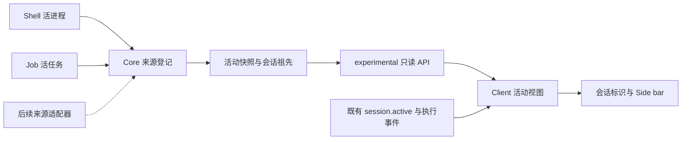

# 会话活动观测：第一阶段实施与验证

日期：2026-11-02。维护线：`dev-my`。实施基线：`85937923012dea1c2b9b4558e226433141778063`。对应 [设计 v0.2](session-goal-state.md) 与 [计划 v0.2](session-goal-state-plan.md)。

方案及工作包已获确认。本轮实现 P1-01 至 P1-04，执行 P1-05 自动验证并保留人工验收项。实现已形成两个 `dev-my` 本地提交，本文档单独提交；未推送、发布安装包、修改或新建 PR，不发出测试邀请。`oc-headless`、`qtoc-headless` 及正在运行的 OpenCode 实例均不作为修改或重启对象。

| 本地提交                                                            | 工作包                                                        |
| ------------------------------------------------------------------- | ------------------------------------------------------------- |
| `bdddb73067` — `feat(core): observe session background activity`    | P1-01 / P1-02：来源、聚合、协议、服务端、生成客户端及后端测试 |
| `2e093e66c0` — `fix(app): retain sessions with background activity` | P1-03 / P1-04：共享同步、界面、英文源词条及客户端/界面回归    |

## 用户可见行为

- 父会话模型停止输出后，只要本会话或后代还有可观测工作，Side bar 运行区和会话忙碌标识继续显示。
- 只有后台工作时显示 `Background work`；悬停可查看模型、子智能体、shell、其他任务的数量与工作名称。点击运行行仍定位到该行所属会话，子会话可独立进入。
- 子智能体 Job 与同一子 Session 的模型执行合并为一个工作；shell 与承载它的 Job 不重复统计。父会话摘要汇总后代，父行与子行是两个会话入口，运行区标题计数仍表示会话数，不是唯一任务数。
- 首次同步、重连、观测不可用和断线有对应提示；只有模型快照与后台快照都完成同步，才显示没有运行会话。旧快照不能覆盖读取期间的新通知。
- 继续使用现有常显运行区、滚动高度限制、项目分组和收起/展开。官方四种模式的导航保持原有定义，共享忙碌标识可以反映新增活动。
- 动画仍使用现有 `ActivityRing`，尊重减少动态效果偏好；静态图标、文字和数量同样表达活动。新增文案按 `packages/app/AGENTS.md` 使用英文源词条及复数 API，中文等语言使用既有英文回退，本次未添加未经语言评审的译文。

这里的空闲和执行结束都不是“当前目标已达成”。后台工作的成功、失败和取消结果继续在其已有消息、输出和工具入口中查看；本轮不汇总目标成败。

## 分层与扩展边界

1. **来源层**：`packages/core/src/session/activity-source.ts` 维护作用域内的读取回调。Shell 和 Job 各自提供真实运行事实；登记层没有调度、超时、持久计数或历史 Job 扫描。来源作用域关闭即移除并通知刷新。
2. **聚合层**：`packages/core/src/session/activity.ts` 去重，查询实际所属 Session 及现存祖先，排除已删除的所属会话。单次读取复用祖先查询；不启动 Location，不因查看状态登记项目或恢复工具。
3. **协议层**：Schema 定义独立 `SessionActivity.Work/Info`；新增 `GET /api/experimental/session/activity`，OpenAPI ID 为 `experimental.session.activity`，返回 `{ data: [...] }`。字段为 `id`、`sessionID`、`kind`、可选 `title`、`startedAt`、`ancestors`。祖先按直接父级优先排列。
4. **同步层**：`packages/client/src/solid/session-activity.ts` 合并新增后台快照与原有模型执行缓存，提供 `list/busy/active/since` 和数据可用性。已有 `session.status/active` 保持模型执行语义。UI 不读取 Core/Server。
5. **展示层**：`active-sessions.tsx` 与 `project-avatar-state.ts` 消费综合活动；发送、queue/steer、中断和模型停止按钮继续依赖已有执行状态。

实施时保留了两个上游事实入口：执行状态继续通过稳定的 `session.active` 与执行事件同步；新增接口只补齐缺少的后台来源。客户端统一派生综合活动，避免服务端再复制一个执行状态缓存。它落实计划的统一观测目标，同时减少修改上游执行 coordinator 的范围。

来源扩展仅需在其所属作用域登记符合 `Work` 的读取回调，并在运行集合变化时发出刷新依据。`kind: job` 为其他已适配工作提供通用显示，不要求 UI 导入来源实现；目前不新增公共插件注册 API。若上游提供统一活动接口，可替换读取适配或逐一迁移来源，保留客户端与 UI 的观测契约。后续 Goal 评审可在 Core 层复用后台事实与既有执行事实；客户端仍只同步与展示摘要，不承载服务端目标评审或来源生命周期。

## 来源与身份契约

| 来源                           | 唯一工作身份               | 所属会话                   | 活跃依据与结束依据                                                |
| ------------------------------ | -------------------------- | -------------------------- | ----------------------------------------------------------------- |
| 顶层模型执行                   | `session:<SessionID>`      | 本会话                     | 原有 active 快照、started / succeeded / failed / interrupted 事件 |
| 子 Session 执行 / subagent Job | `session:<childSessionID>` | 子会话                     | 任一实时来源仍活跃即保留；两来源同时存在只计一次                  |
| 模型 shell、用户手动 shell     | `shell:<ShellID>`          | shell 元数据中的 SessionID | Shell 的活进程列表；退出、超时、kill、删除或来源释放后移除        |
| 内置 image Job                 | `job:<JobID>`              | recovery 中的 SessionID    | Job 当前内存状态为 running；完成、失败、取消后移除                |
| 后续已接入来源                 | 来源限定的稳定 ID          | 实际所属会话               | 由适配器提供当前事实及变化通知                                    |

Shell 元数据的 SessionID 在适配边界通过 Schema 校验。没有会话归属的独立 shell 不擅自挂到当前会话。Job 中的 shell 不另计一份，已完成但尚未消费的通知也不算运行。

现有 `shell.created/exited/deleted` 触发全局刷新，包含尚未加载的 Location。Job 缺少统一生命周期事件，因此增加无负载的临时事件 `experimental.session.activity.changed`；不新增持久领域事件。连接建立后读取当前快照，查询中收到失效通知即丢弃旧结果并串行重读，同一服务器共享读取，不按会话行轮询。

## 保持不变与覆盖限制

- 不合入 #53211 或 #60375 的执行策略；不改变自动后台化、等待超时、取消、Stop/Esc、子智能体收尾或用户 shell 的 `resume: false` 通知行为。
- 不新增数据库表或迁移，不把未消费的持久 Job 恢复标记当成活进程。进程重启后，原有恢复逻辑重新建立的实际运行工作才重新出现。
- 旧后台不支持新增 API 时，保留模型执行观测并提示活动状态不可用，不声称后台没有工作。
- 仅覆盖具有会话归属的 Shell、内置 subagent/image Job 及模型执行。外部进程、普通终端/PTY、没有适配器的插件工作和脱离 Shell 管理的后代进程不在当前保证范围。
- 活动接口沿用现有服务认证及与 `session.active` 相同的全服务器观察范围。没有增加执行能力或目录访问操作。
- 活动变化与网络刷新之间有短暂延迟；同步期间保留已有行，空列表同步未完成时提示加载。后台工作结果是否满足当前目标，仍需后续阶段判断。

## 自动验证

全部测试使用隔离数据或浏览器夹具；未连接、重启或改变用户运行实例的主题和动态效果。

| 验证                                 | 结果与覆盖                                                                                                                      |
| ------------------------------------ | ------------------------------------------------------------------------------------------------------------------------------- |
| 根目录 `bun run check`               | 35/35 任务成功；lint 0 error，仓库既有 warning 保留。Node 22.16 按维护文档设置 `NODE_OPTIONS=--experimental-strip-types`        |
| Core 聚合、Job、执行、真实用户 shell | 64 pass / 0 fail，392 assertions；并行 shell、只登记完成通知而不唤醒、子任务结束、取消及恢复标记                                |
| Client 活动与共享数据                | 两个测试文件重复 10 次：400 pass / 0 fail，1,940 assertions；去重、后代归属、未加载目录、快照竞态、重连、旧接口回退、双快照就绪 |
| Server 实际路由与会话创建            | 3 pass / 0 fail；新 API 空快照及原有 active 接口均正常                                                                          |
| Protocol experimental 标识           | 1 pass / 0 fail                                                                                                                 |
| 客户端生成                           | 在 `packages/client` 执行 `bun run generate`；生成文件未手工维护                                                                |
| 生产 UI 构建与新增场景               | 构建成功；新场景覆盖父会话、子智能体、孙级 shell、数量、导航、重载及最后一个工作结束                                            |
| UI 重复回归                          | 4 个场景 × 5 轮、5 workers：20 pass / 0 fail；新场景、四种模式、跨服务器/项目运行区、常显和高度边界                             |

补充验证：

- Core 活动聚合测试重复 10 次：20 pass / 0 fail，80 assertions。
- `tool-shell`、`tool-subagent`、`subagent-lifetime`、`shell-cleanup`：52 pass / 0 fail，240 assertions；33 项按现有 Windows 或 shell 可用性条件跳过，不能写成跨平台全通过。
- 项目整组折叠、后代忙碌及动画恢复、项目分组导航：3 pass / 0 fail。
- 将已提交的三处 UI/客户端生产入口临时还原到实施基线，构建独立对照包后在 `finally` 中恢复实现；新回归用例在对照包中因父会话运行行缺失而失败，在新实现中通过。对照包仅用于验证，没有替换用户应用。

独立执行 `packages/app` 的 `bun run typecheck:e2e` 仍有 **13 处未修改文件中的类型错误**，位于 composer、review、settings、timeline 和 performance 旧夹具等位置。本次新增用例、修改的 tabs 用例和 mock 夹具无报错；不将独立 E2E 全量类型检查写成通过，也不在本轮扩大修改范围。

验证日志位于本工作树 `.cache/activity-*.log`。沙箱中的 Bun 不能正确解析部分 workspace 依赖，生成、构建及检查改在获准的沙箱外环境运行；未为此重装或修改依赖。

## 性能与补充验证

实施前对生产构建执行 home/tab navigation benchmark 3 轮。打开 Home 会话并绘制标签场景 3/3 通过，可作为比较基线；另两个既有场景各 3 次失败（review 展示及关闭唯一标签），不当作有效基线或本次回归通过。

同一 Windows 主机、Chromium、生产构建、单 worker、无重试的记录如下。单位为毫秒，报告稳定绘制时间中位数；附范围避免只选择有利样本。

| 构建与批次                 | 样本数 / 成功数 | 内容中位数（范围）     | 标签中位数（范围）   |
| -------------------------- | --------------- | ---------------------- | -------------------- |
| 实施前初始基线             | 3 / 3           | 582.6（479.4–846.5）   | 98.0（84.6–146.9）   |
| 新实现首次比较             | 3 / 3           | 849.8（518.7–868.8）   | 125.8（107.4–154.9） |
| 同一新构建追加采样         | 5 / 5           | 1447.9（863.3–1801.2） | 143.2（121.5–170.6） |
| 修改前显示逻辑的独立对照包 | 5 / 5           | 1095.2（943.7–1459.1） | 129.9（125.5–157.2） |

对照包保留同一依赖与测试夹具，将 `client/src/solid/data.ts`、`app/src/shell/titlebar/active-sessions.tsx`、`app/src/shell/layout/project-avatar-state.ts` 恢复到基线内容后单独构建。实际后台为夹具，因此该对照只评估客户端与显示路径，不代表真实后台吞吐性能。

**不作性能无退化结论。** 新实现后两批相差明显，对照包也慢于最初基线；同期系统采样为总 CPU 100%、可用内存 6.73 / 31.88 GB。追加采样中新实现内容中位数仍高于同环境对照约 32%，不能仅以环境忙碌解释掉这个差异，也不足以归因到某一处代码。功能断言均通过，但应在较空闲环境交替测量同一场景后，再关闭性能关注项；G1 人工验收同时关注会话打开和侧栏响应。

具体日志：`.cache/activity-baseline.log`、`activity-after-benchmark.log`、`activity-repeat-benchmark.log`、`activity-control-benchmark.log`、`activity-e2e-control.log`。临时对照源码已恢复；正式本地提交包含新增活动观测实现。

## G1 人工验收项

以下是本地验收清单，不是对外测试邀请；本轮没有发行新的安装包。

1. 模型回复结束但当前会话 shell 继续运行时，父会话仍在运行区，数量、名称和计时对应实际任务。
2. 子智能体单独运行，以及子智能体模型结束但孙级 shell 继续运行时，父/子入口保持可见；可定位实际所属会话。
3. 并发任务逐一成功、失败、取消后，数量下降，最后一个退出后清除运行标识；结果仍能在已有入口查看。
4. 断线重连、冷启动和后台重启后，显示与真实存活任务一致；旧通知不制造幽灵任务。长期服务持续可见。
5. 后台独自运行时，发送、中断和用户 shell 完成通知的行为保持原义；项目折叠、列表切换、四种模式和系统减少动态效果正常。

**G1 尚未确认。第一阶段验收前，P2 Goal 完成摘要与 P3 动态目标评审均不推进。**
