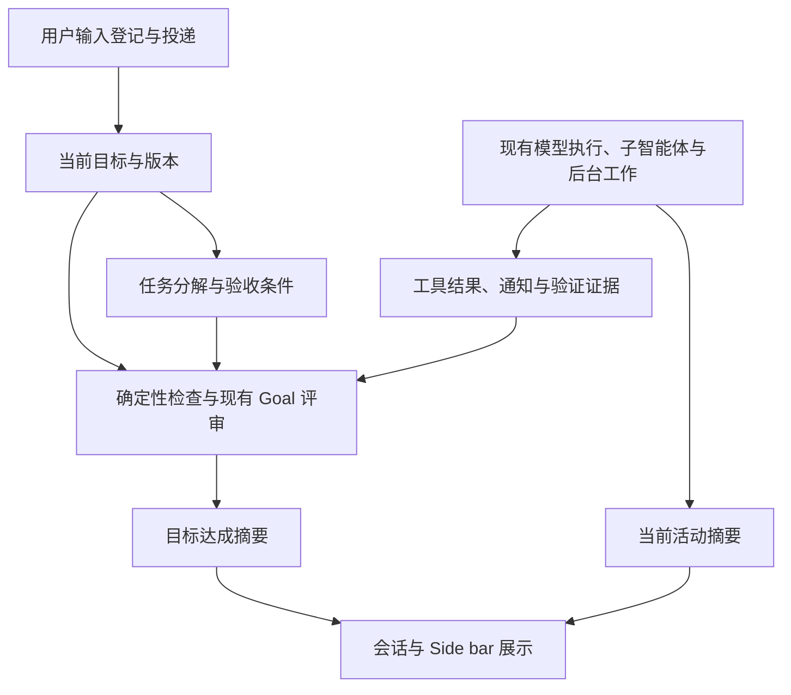

# 会话当前目标与活动状态设计

版本：**v0.2**。日期：2026-11-02。维护线：`dev-my`。状态：方案与工作包已确认，第一阶段已实施，等待验收；动态目标评审尚未开始。实施边界与验证见 [第一阶段验证记录](session-goal-state-validation.md)。

本版沿用 v0.1 的目标、执行与证据分层，仅收敛状态、明确阶段边界并调整组织。开发顺序与验收条件见 [开发任务计划](session-goal-state-plan.md)；既有代码、issue 和 PR 的分析统一放在文末附录，其来源版本沿用上一轮核对快照。

## 总体设计

会话顶层同时回答两个问题：**当前目标是否达成，以及当前有哪些活动**。目标描述用户要得到的结果；模型步骤、子智能体、shell 和其他工具提供推进过程与验证证据。一个目标可以跨越多次执行和异步恢复，回复结束不会直接决定目标完成。

沿用现有 Session 输入投递、执行 coordinator、Job 和 Goal 评审机制，在其上提供统一摘要。目标判断与自动续跑分工明确：前者解释完成情况，后者继续受显式 `/goal` 控制、暂停和预算约束。观察状态本身不会启动工具、恢复暂停的任务或扩大执行授权。

### 两个维度，少量状态

| 维度     | 状态   | 含义                                                               |
| -------- | ------ | ------------------------------------------------------------------ |
| 目标达成 | 待判断 | 当前诉求或有效证据尚不足以给出结论，包括新诉求待纳入、旧评审已失效 |
| 目标达成 | 未达成 | 已明确仍有必要工作或验收条件未满足                                 |
| 目标达成 | 已达成 | 当前版本的验收条件得到证据支持，完成判断仍有效                     |
| 当前活动 | 运行中 | 本会话或后代存在活跃执行，或仍运行的可观测后台工作                 |
| 当前活动 | 空闲   | 完整且有效的活动快照中没有上述活动                                 |

“等待测试”“等待人工验收”“评审中”“等待授权”等用一条简短原因解释，不分别增加顶层状态。已有暂停、失败、中断和排队信息继续由各自对象表达，不复制成另一套会话状态机。活动数由现有对象派生，不维护独立持久计数。

连接中断、首次同步未完成或活动数据失效时，显示现有连接/同步提示，不能把缺失数据解释为空闲。这是数据可用性约束，不增加第三种业务活动状态；只有已知数据完整时才能肯定显示空闲。

### 用户看到的组合

| 使用情形                                | 目标达成 | 当前活动 | 简短说明                                 |
| --------------------------------------- | -------- | -------- | ---------------------------------------- |
| 必需的后台测试仍运行，模型暂时结束回复  | 未达成   | 运行中   | 等待测试 · 1 个 shell                    |
| 子智能体还在审查                        | 未达成   | 运行中   | 等待审查 · 1 个子智能体                  |
| 工作结束，尚无有效评审结论              | 待判断   | 空闲     | 等待复核                                 |
| 自动评审正在模型中执行                  | 待判断   | 运行中   | 正在评审；按实际执行可观测性呈现         |
| 只剩用户人工验收                        | 未达成   | 空闲     | 等待人工验收                             |
| 目标通过验证，开发服务器继续运行        | 已达成   | 运行中   | 1 个后台服务                             |
| 当前目标完成，还有明确 queue 的后续诉求 | 已达成   | 空闲     | 1 条排队诉求；若开始执行则活动变为运行中 |

后台测试或子任务与目标的“必要”关系由任务要求和证据确定，不能凭存在一个进程就断言目标未达成。已有有效结论时，是否失效取决于相关诉求或证据是否变化；单纯刷新界面不触发重评。

## 架构与职责

Session 保持为可继续的对话容器，顶层展示一个当前目标；旧目标及其完成结论留在历史中。任务分解是组织工作的方式，Job 是实际工作单元，step 仍表示一次模型调用，不另建执行循环或通用工作流引擎。

服务端提供统一的活动事实和目标结论，客户端负责展示。首期优先组合既有接口与事件；能力不足时才增加窄的 experimental 读接口。目标部分复用现有 Goal 的 schema、存储、RPC、idle hook 和 reviewer；保留现有 `Goal.State.status` 与自动续跑语义，新增展示摘要不直接替换它们。

新增目标评审通过 experimental 开关逐步启用，开关只控制观测和评审能力，不隐含自动续跑授权。未启用时沿用既有行为。

只增加判断所必需的信息：当前目标的版本与来源输入、必要验收条件及证据引用、评审使用的输入/证据边界。任务 ID 或工作关联在确有跨步骤追踪需要时扩展；现有 Todo 可先作为计划线索，不强制所有会话建立任务图。

持久化只记录目标修订、验收调整和有效评审结论等新事实。运行列表、家族汇总和活动计数从已有记录派生。Schema、Core、Protocol、Server、Client 的依赖方向遵循仓库规范，客户端不直接依赖 Core 或 Server。

## 当前活动的观测

活动摘要覆盖本会话和可确认归属的后代：模型执行、内置子智能体、后台 shell、image 等已登记工作，以及可关联的用户手动 shell。归属不明或尚未接入的插件后台工作明确作为覆盖限制，不能宣称所有外部进程均已纳入。

同一个子智能体可能同时对应 Job 和子 Session，同一个 shell 也可能被多种事件引用。按实际工作身份去重，再沿父子关系汇总；顶层摘要必须看到孙级任务，既有子会话入口仍保留。避免一个父会话和其子 Job 被重复计成两个子智能体。

运行事实与结果处理分开表达：进程结束后退出运行计数，结束结果按现有机制保留；通知仅登记、已投递或尚未评价，不能直接作为目标达成依据。队列中有输入也不自动等于正在执行，但仍保留待处理提示。

快照和增量事件必须一致，首次打开、断线重连和任务快速结束后，都应恢复相同结果。重启后的旧 claim、旧 Job 标记不能单独证明进程仍在运行；按现有恢复机制确认活动，恢复前显示同步提示。

长期服务持续显示为活动，这是正确的运行信息。它是否阻止目标完成在后续目标评审中按用途判断；首期观测不推断服务意图，不修改超时、自动转后台、通知投递或子智能体收尾规则。

## 动态目标与完成判断

### 用户输入推动目标修订

继续沿用输入先登记、再投递的顺序，以及 steer/queue 的既有规则。

| 场景                                 | 目标处理                                                                       |
| ------------------------------------ | ------------------------------------------------------------------------------ |
| 首个用户任务                         | 在目标评审阶段建立可追溯的当前诉求；范围未明确时显示待判断，不隐式启用自动续跑 |
| 新的相关 steer                       | 登记后使旧完成判断暂时失效，说明“新诉求待纳入”；投递采纳后修订目标版本         |
| 明确 queue 的后续任务                | 保持当前目标，单列排队诉求；投递时再修订或建立新目标                           |
| queue 提升为 steer、取消或改回 queue | 随现有输入事实重新计算有效性，不产生虚假的目标修订                             |
| 用户补充约束、替换目标               | 补充同一目标时增加版本；更换目标时使用新 ID，保留旧结论的归属                  |
| 询问进度、致谢或引用材料             | 不仅因收到消息就增加任务；意图不明时待判断并保留原始输入                       |
| 停止或暂停                           | 遵循现有执行控制；目标判断保留独立含义，暂停不等于达成                         |

模型可帮助归纳目标和验收条件，但需保留来源，允许用户更正，不得悄悄删除尚未满足的要求。同一输入重试遵循既有幂等规则；后台通知、Goal synthetic 续跑消息和压缩控制项只影响进展或证据，不形成新的用户目标。

### 事实检查与证据评审

完成判断使用三个步骤：

1. **确认判断对象有效。** 固定目标版本及输入/证据边界；明确相关的必要工作和验收条件。
2. **检查完成依据。** 必要工作已结束，结果已投递并经过评价，验收条件得到工具输出、文件、测试或用户确认支持。再复用 Goal reviewer 评估整体目标。
3. **保存前复核。** 若评审期间相关诉求或证据变化，旧结论只属于旧快照，不能覆盖当前目标。

已有明确缺失项时显示未达成；尚无可信结论时显示待判断；只在当前版本的证据充分且评审有效时显示已达成。等待结果、缺人工验收和评审错误由原因说明，不继续扩张状态枚举。

例如，评审“完成实现”时用户追加“还需 Windows 人工测试”，旧 reviewer 的 done 不能使新诉求显示已达成。先提示新诉求待纳入，采纳后显示“未达成 · 等待人工验收”。

普通输入不会自动改变现有 Goal ID，因此后续实现需在拥有输入登记/投递顺序的服务端边界校验有效性。现有插件能力不足时增加窄的 hook 或读模型支持；不使用客户端时间戳代替一致性保证，也不在本次第一阶段提前实施该机制。

### 任务与证据的简单约束

- Todo completed 和助手的完成声明只是线索，不能替代验证。被取消的任务只有在用户撤销对应要求或确认不再必要后，才能移除验收约束。
- shell 返回非零、测试失败或子任务交付不完整，应保留原因并允许修复重试；不把一次工具失败永久固定为整个目标失败。
- 必要的有限任务须取得并评价结果。长期服务在就绪条件满足后可支持目标达成，同时继续显示运行；用途不明时待判断，不自动忽略或无限等待。
- 通知被确认不等于结果已经验收。后续模型步骤或 reviewer 应结合结果作出评价，人工验收条件仍由用户确认。
- 简单任务可以直接判断，不强制创建 Todo 或复杂依赖图。reviewer 失效、超时或证据不足时不能回退为已达成。

评审在安全边界合并触发，并按相关输入和证据变化去重；不由列表刷新、输出 chunk 或计时器反复触发模型调用。暂停与自动续跑预算仍由现有 Goal 控制。

## 界面与第一阶段边界

Side bar 的 Running sessions 保持常显及现有高度限制，展示活动会话和可定位的后台工作。目标状态显示在会话摘要处，具体活动数量和主要原因按需展开。项目汇总从同一份摘要派生，不另外维护一套项目生命周期。

官方三种模式保持各自导航与布局，活动观测接入共享数据层。状态图标遵循减少动态效果设置，文字与静止图标仍须表达状态。对只有后台工作的会话，不把新增的活动标识直接接入原有“中断模型”按钮；继续使用对象已有的操作，避免把观测扩展成新的停止策略。

**第一阶段只完成活动观测闭环**：后台独自运行、子智能体及后代工作可见；打开和重连后状态一致；工作结束能正确更新。第一阶段不新建普通会话的目标评审，也不依据空闲生成目标已达成。现有显式 Goal 展示保持其原有语义。

工具是否转后台、转后台时机、超时、通知的 resume 策略、子智能体最终收尾及现有中断行为均继续使用当前实现。发现这些行为的问题时记录为后续依赖，不将其夹带进观测补丁。

## 渐进交付与评审

| 阶段                   | 交付                                         | 完成门槛                                               |
| ---------------------- | -------------------------------------------- | ------------------------------------------------------ |
| 第一阶段：活动观测     | 统一家族活动、快照/订阅、客户端展示          | 工作包划分确认后实施；自动验证与人工验收通过           |
| 第二阶段：目标评审基础 | 复用 Goal 的只读完成摘要与最低限度的失效校验 | 第一阶段通过后推进；能够保守处理新输入，不展示过期达成 |
| 第三阶段：动态目标闭环 | 目标修订、验收关联、结果评价与人工确认       | 在第二阶段基础上完成动态输入及恢复场景验证             |
| 后续可选项             | 更广的插件观测、Job 控制或执行策略改进       | 单独评估，非前三阶段的默认依赖                         |

第二阶段先覆盖显式 Goal；没有可靠目标和版本依据的普通会话保持待判断。它必须具备新输入使旧结论失效的基本保护，不能把防止错误完成拖到第三阶段；第三阶段再补齐自动修订和完整验收关联。

具体工作包、依赖与验收清单见 [开发任务计划 v0.1](session-goal-state-plan.md)。本次仅更新设计和计划；按用户要求等待工作划分评审确认后，再在 `dev-my` 实施第一阶段。后续阶段基于实际验证结果推进，不整包引入尚未评估的执行策略。

## 版本记录

| 版本 | 调整                                                                                                                           |
| ---- | ------------------------------------------------------------------------------------------------------------------------------ |
| v0.1 | 建立目标、活动、任务和证据分层；核对上游机制及相关 PR                                                                          |
| v0.2 | 总体设计前置；目标收敛为三态、活动为两态，原因与既有控制信息辅助说明；明确观测阶段范围；将现状和 PR 分析移入附录，配套开发计划 |

## 附录 A：既有分析基线

| 对象                            | 本次核对的版本                                                                                              |
| ------------------------------- | ----------------------------------------------------------------------------------------------------------- |
| 本地 `dev-my`                   | `85937923012dea1c2b9b4558e226433141778063`，实现来源包含 `ca18869aaa1b8c92e93c7db5a1d803e78830eefc`         |
| 本地已合入的上游                | `69269e4ebe309a08919b3c9be7948b9fd699c3a4`，合并提交 `a7b90e8444`                                           |
| 上一轮分析获取的 `upstream/dev` | `e5c9b0151b2ea0e8d82cb6567139399589f4d08d`，仅获取和比较，没有合并                                          |
| PR #53211                       | open、未合并；head `c6349d5ee5dbcfd5e9c477e0800b258a5ca24d1e`                                               |
| PR #60375                       | open、未合并；head `52a16c689bf9a3782c37b0bc8cfdd0c755aa206a`                                               |
| PR #60367                       | open、未合并；最新 head `794b7169e03c9a9936cdb243d13116376006a415`；#60375 基于其较早提交 `393101fd88` 叠加 |

附录代码链接固定在这些提交，PR 状态和合并预检沿用 v0.1 分析时的快照；本次文档重组未重新查询远端。合并冲突属于静态预检结果，不代表完成了功能验证。上游 `specs/v2` 记录现行契约；本提案放在 fork 文档中，避免把尚未实现的设计写成官方规范。

## 附录 B：现有上游状态与 Goal 的边界

### 执行结束与目标达成是不同事实

| 信息                                            | 当前含义                                              | 不能据此推断的结论                   |
| ----------------------------------------------- | ----------------------------------------------------- | ------------------------------------ |
| `Session.Info.outcome`                          | 最近一次结束的执行为 succeeded、failed 或 interrupted | 当前用户目标已经完成                 |
| `SessionExecution.active` / `sessions.active()` | 本进程当前拥有的执行忙碌期                            | 会话家族中不存在后台工作             |
| shell / Job 状态                                | 进程或工作单元的生命周期                              | 命令成功、结果满足验收条件           |
| 后台通知确认                                    | 结果通知已进入会话输入通道                            | 模型已消费结果，并完成检查和后续处理 |
| Todo completed                                  | 模型提交的任务清单状态                                | 全部诉求都有充分证据支持             |
| `/goal` complete                                | 独立评审认为已保存的目标达成                          | 后来追加的诉求已经成为该目标的新版本 |

当前 `SessionExecution.terminal` 在执行正常返回时生成 succeeded。工具执行成功只代表工具协议正常完成：例如 shell 正常返回非零退出码，仍可能是一次成功返回结果的工具调用；业务验收必须检查退出码、输出和任务要求。一次失败后修复重试成功，也不应使目标永远失败。[执行终止分类](https://github.com/anomalyco/opencode/blob/e5c9b0151b2ea0e8d82cb6567139399589f4d08d/packages/core/src/session/execution.ts#L47-L51)、[工具结果契约](https://github.com/anomalyco/opencode/blob/e5c9b0151b2ea0e8d82cb6567139399589f4d08d/specs/v2/tools.md)。

V2 的一个 step 对应一次模型调用；一次执行可包含多个 step，一个目标又可能跨越多次执行和异步恢复。当前目标应在这些事实之上汇总，不改变 step 的含义，也不另建内存工具循环。它与将来可能引入的 assistant-turn 单元也不应混为一谈。

后台 shell 的现行工具说明允许智能体在等待期间结束回复，并在完成通知到达后恢复。因此，“回复结束但 shell 仍运行”本身是已有异步设计；把这次回复结束展示成整个用户目标完成，才是需要补足的表达。[shell 的后台说明与通知实现](https://github.com/anomalyco/opencode/blob/e5c9b0151b2ea0e8d82cb6567139399589f4d08d/packages/core/src/tool/plugin/shell.ts)。

还需区分模型工具 shell 与用户手动 shell。`Session.shell` 的完成通知使用 `resume: false`，不会自动唤醒模型。目标状态可以观察它，但不能仅因新增评审功能就改变手动命令的唤醒策略。[用户 shell 契约](https://github.com/anomalyco/opencode/blob/e5c9b0151b2ea0e8d82cb6567139399589f4d08d/specs/v2/session.md#L41)。

### 上游 Goal 已有的基础与边界

现有 `/goal <objective>` 显式创建目标；`Goal.State` 保存目标正文、active/paused/complete、原因、续跑轮次、停滞计数和服务器 boot。客户端通过 `opencode.goal` RPC 读取并订阅变化，子会话与 fork 不继承目标。它是可选的自动完成机制，不是所有会话默认拥有的状态。[Goal schema 与 RPC](https://github.com/anomalyco/opencode/blob/e5c9b0151b2ea0e8d82cb6567139399589f4d08d/packages/schema/src/goal.ts)。

在即将 idle 的边界，插件调用独立 reviewer，根据对话里的工具结果、命令输出和文件内容判断 done、continue、blocked、paused，存在本会话后台 shell 时还允许 wait。它明确要求不能把助手自己的完成声明当作证据，并要求不要等待长期运行的开发服务器。[评审入口](https://github.com/anomalyco/opencode/blob/e5c9b0151b2ea0e8d82cb6567139399589f4d08d/packages/core/src/plugin/goal.ts#L105-L205)、[评审规则](https://github.com/anomalyco/opencode/blob/e5c9b0151b2ea0e8d82cb6567139399589f4d08d/packages/core/src/plugin/goal/judge.txt)。

这些约束适合继续沿用：idle 边界评审、通过 synthetic 输入继续现有 runner、最大轮次与停滞保护、上下文过长时压缩、用户暂停、重启后暂停。当前默认上限为 50 次续跑、连续 3 次停滞；后台等待看门狗在 30 分钟没有相关执行进展后暂停，后代会话的 step 活动可以重置等待计时。[Goal 实现](https://github.com/anomalyco/opencode/blob/e5c9b0151b2ea0e8d82cb6567139399589f4d08d/packages/core/src/plugin/goal.ts)。

但将它提升为普通会话的顶层状态，还存在以下边界：

- 普通追加消息不会自动修订保存的 objective；上下文中虽然能看到新消息，却没有明确的“本次完成结论针对哪一版诉求”。
- 当前结构没有验收条件、任务与 Job 的关联、证据引用或目标版本。blocked 最终保存为 paused，不能直接为界面提供细分原因类型。
- idle hook 会等待本会话拥有的子智能体和图像任务；shell 的 wait 判断只列出本会话的 shell。后代遗留 shell 的通知先唤醒其所属会话，不能假定它会直接唤醒顶层目标。
- 后台观测覆盖内置 shell、subagent、image，不代表所有插件异步工作都可见。[#60860](https://github.com/anomalyco/opencode/issues/60860) 报告了插件后台工作难以纳入该边界的情况。
- reviewer 返回后主要复核目标 ID 和 active 状态；普通输入不会改变这两个字段。若评审期间用户追加了变更，旧上下文的 done 可能先被保存，再处理新输入。需要明确版本与输入边界，而不是增加更多“忙碌”图标来补偿。

`SessionBackground.outstanding` 已能沿父子关系收集后台工作，是复用入口；它收集的是运行中的工作，不是从启动到通知消费、验收到完成的全过程账本。[后台工作汇总](https://github.com/anomalyco/opencode/blob/e5c9b0151b2ea0e8d82cb6567139399589f4d08d/packages/core/src/session/background.ts)。

## 附录 C：PR 设计差异与合入风险

| 维度               | #53211                                         | #60375                                                                 |
| ------------------ | ---------------------------------------------- | ---------------------------------------------------------------------- |
| 主要问题           | 前台执行收尾时后台工作尚未确认，却发布结束     | 慢工具长期阻塞、通知生命周期不稳定、Job 缺少观察和控制                 |
| 状态策略           | 新增非终态 waiting；等待期间不发布成功终止事件 | 执行可以结束；`session.active` 合并执行和运行中的 Job                  |
| 默认工具行为       | 不引入 30 秒自动转后台                         | shell、execute、subagent 默认 30 秒转后台，`yield_after: 0` 立即转后台 |
| 子智能体收尾       | 等待其后台通知，再恢复子会话并读取最终文本     | 等待其后台 Job 结束和通知确认，再恢复并收尾                            |
| 通知机制           | 在现有 durable background marker 上增加等待    | 全局 Job scope 的 onSettle、确认与有限完成历史                         |
| 用户与模型可操作性 | 主要是状态呈现与结果收尾                       | 新增 Job 查询、读输出、等待、停止工具及 API/event                      |
| 当前目标修订与验收 | 未提供                                         | 未提供                                                                 |
| 与当前基线的关系   | 较早的 Job 实现，需要迁移适配                  | 叠加 #60367，改动横跨执行、工具、协议、客户端                          |

### #53211：把后台等待纳入结束判断

其核心链路是：执行正常返回 → `jobs.awaiting(sessionID)` → 发布 waiting → 释放执行恢复 claim，但不发布 `Execution.Succeeded`。等待的依据是后台通知的持久标记，等待期的恢复由后台记录承担。子智能体收尾循环等待通知确认，再恢复子会话，以避免把结果尚未处理的回复提前交给父会话。[执行收尾](https://github.com/anomalyco/opencode/blob/c6349d5ee5dbcfd5e9c477e0800b258a5ca24d1e/packages/core/src/session/execution.ts#L120-L156)、[Job 等待](https://github.com/anomalyco/opencode/blob/c6349d5ee5dbcfd5e9c477e0800b258a5ca24d1e/packages/core/src/job.ts#L455-L511)、[子智能体收尾](https://github.com/anomalyco/opencode/blob/c6349d5ee5dbcfd5e9c477e0800b258a5ca24d1e/packages/core/src/session/subagent-job.ts)。

它较直接地修正完成勾选、TUI 忙碌展示和嵌套子智能体提前收尾，且没有同时修改慢工具的默认策略。但 waiting 仍表示“有待确认的后台工作”，不是“目标尚未达成”的完整判断：无后台工作时仍可能缺少测试、人工确认或其他验收步骤；长期服务也可能留下无法自然结束的等待。

接入 `dev-my` 不能只移植枚举和图标。该 PR 的 `SessionExecution.active` 仍使用 coordinator 的执行所有权；客户端重建 active 快照时把 API 返回的 ID 统一标记为 running，而 waiting 由瞬时事件写入。这存在重连后等待状态不能完整重建的兼容缺口。本地 `sessionBusy` 的活动状态分支和 `data.session.active()` 又只认 running，需明确等待是否进入 Running sessions，并补齐快照与订阅的一致性。[PR 客户端](https://github.com/anomalyco/opencode/blob/c6349d5ee5dbcfd5e9c477e0800b258a5ca24d1e/packages/client/src/solid/data.ts)、[本地忙碌判断](../../../packages/app/src/shell/layout/project-avatar-state.ts)。这是静态分析识别的缺口，尚未运行该 PR 复现。

此外，它的 Job 查询按较早的 shell/subagent recovery 结构实现；当前上游已经使用 SQL JobTable 并支持 image。直接恢复旧版 Job 文件会丢失后续上游演进，必须按当前存储和任务种类移植。等待期间的中断、revert 和终止事件配对也需要重新验证。

### #60375：统一 Job 生命周期并使慢工具自动异步化

该 PR 将 Job 的结束通知放入全局 scope，避免仅依赖 Location/plugin 生命周期；增加 `job_list`、`job_output`、`job_wait`、`job_stop`、`job.updated` 和 experimental session jobs API。运行中的 Job 会让所属会话继续出现在 active 快照中，客户端也接入 Job 变化。这比单独新增 waiting 更接近完整的后台工作读模型。[Job 实现](https://github.com/anomalyco/opencode/blob/52a16c689bf9a3782c37b0bc8cfdd0c755aa206a/packages/core/src/job.ts)、[active 合并](https://github.com/anomalyco/opencode/blob/52a16c689bf9a3782c37b0bc8cfdd0c755aa206a/packages/core/src/session.ts#L511)、[PR 设计说明](https://github.com/anomalyco/opencode/pull/60375)。

其主要代价是执行行为变化。超过默认 30 秒的工具先返回 running 和 jobID，后续结果通过通知继续；shell 转后台后清除隐式两分钟超时，显式 timeout 仍保留。模型、插件、Code Mode 和客户端都必须能处理“工具已返回，但实际工作未结束”。这超出了修复 Side bar 状态的范围。[shell 调用实现](https://github.com/anomalyco/opencode/blob/52a16c689bf9a3782c37b0bc8cfdd0c755aa206a/packages/core/src/tool/plugin/shell.ts)。

它还叠加了 [#60367](https://github.com/anomalyco/opencode/pull/60367)：用户提交 steer 时，服务器把可后台化的阻塞工作转到后台，并移除客户端重复的处理。#60375 的依赖提交不是 #60367 当前最新 head；选择合入时应先决定依赖版本，再审计叠加差异，不能把它当作独立的小补丁。

仍需解决的语义问题包括：

- `active = 执行活动 ∪ 运行中的 Job`，但 `outcome` 仍属于最近一次执行，可能同时出现“执行成功”和“后台 Job 运行”。需要给界面明确分层，不能直接把 active 改名为目标未完成。
- `awaitSessionBackground` 等待 Job 结束及 acknowledged；后者表示通知处理链的确认，不等于模型已经消费和验收结果。新 API 主要列运行中的家族 Job，有限完成历史也不能充当长期验收证据。
- 所有运行 Job 都计入活动时，dev server、watch 命令会让会话一直忙；子智能体若等待自己启动的长期服务，可能永远无法向父会话收尾。[自动评审意见](https://github.com/anomalyco/opencode/pull/60375#discussion_r4417823320) 也指出了这一风险，但这不是维护者已接受的设计结论。
- active 范围扩大后，中断仍从执行 coordinator 进入；后台独自运行时没有活跃执行可供中断。虽然有独立的 job_stop 和 Job 取消能力，普通 Stop/Esc 是否停止用户看到的全部活动，需要端到端验证，不能从 active 扩展自动推出。
- 当前 SQL 持久化、image、用户手动 shell 和插件任务的覆盖情况需要逐项核对；统一 Job API 不自动保证所有异步来源已被纳入。

### 合入代价与选择

| 项目                              | #53211                                                | #60375                                                                |
| --------------------------------- | ----------------------------------------------------- | --------------------------------------------------------------------- |
| 相对其与当前 dev 的共同祖先的差异 | 20 文件，+328 / -35                                   | 50 文件，+3662 / -661，包含叠加的依赖提交                             |
| 与当前 dev-my 的只读合并预检      | 5 个冲突文件                                          | 7 个冲突文件                                                          |
| 主要风险                          | 等待状态与快照、执行终止与恢复语义、当前 Job 存储适配 | 默认异步行为、steer 依赖、Job 生命周期及持久化、公共 API 与客户端联动 |
| 能否独立完成动态目标状态          | 不能                                                  | 不能                                                                  |
| 建议                              | 借鉴等待与子会话收尾规则，按当前基线适配              | 优先评估 Job 观察、通知与控制能力；默认自动后台化单独决策             |

预检使用 `git merge-tree --write-tree --name-only`，未修改工作树、索引或分支。两个 PR 都没有在本地执行其测试，PR 内的测试通过记录属于提交者或自动评审的验证，不能视作 `dev-my` 合入后的证明。

#53211 的冲突为 `packages/app/src/composer/submit.test.ts`、`packages/app/src/session/model.ts`、`packages/client/src/solid/data.ts`、`packages/core/src/job.ts`、`packages/core/src/session/subagent-job.ts`。

#60375 的冲突为 `packages/app/src/composer/submit.test.ts`、`packages/app/src/composer/submit.ts`、`packages/core/src/codemode/tool.ts`、`packages/core/src/job.ts`、`packages/core/src/session/execution/restart.ts`、`packages/core/src/tool.ts`、`packages/core/test/job.test.ts`。

这些数量只能表明接入范围，不能转换成准确工期。两份 PR 在 Job、子智能体收尾和活动语义上重叠，不宜简单依次合并。`dev-my` 具备实验条件，但共享的 dev 后台服务仍会影响真实会话；实现与故障测试应先用独立的数据和服务环境，不能把分支隔离当作运行数据隔离。

## 附录 D：相关 issue 与 PR

- [#56660：后台工作时 Web/Home 状态](https://github.com/anomalyco/opencode/issues/56660) 和 [#51810：TUI 后台工作状态](https://github.com/anomalyco/opencode/issues/51810)：与本次现象直接相关，说明问题不局限于本地 Side bar。
- [#48826：嵌套子智能体收尾](https://github.com/anomalyco/opencode/issues/48826)：说明父子工作交付需要单独处理；历史报告不能代替最新版本的运行验证。
- [#60860：插件后台工作与 Goal](https://github.com/anomalyco/opencode/issues/60860)：提示整体完成判断必须明确可观测范围。
- [#59437：Goal 自动续跑](https://github.com/anomalyco/opencode/pull/59437)：现有目标评审设计的来源；应在此基础上演进，而非另建并行的执行引擎。
- [#53211](https://github.com/anomalyco/opencode/pull/53211)、[#60375](https://github.com/anomalyco/opencode/pull/60375)、[#60367](https://github.com/anomalyco/opencode/pull/60367)：分别涉及等待状态、统一 Job 与自动后台化、steer 时后台化；均需跟随实际合入版本重新评估兼容性。
